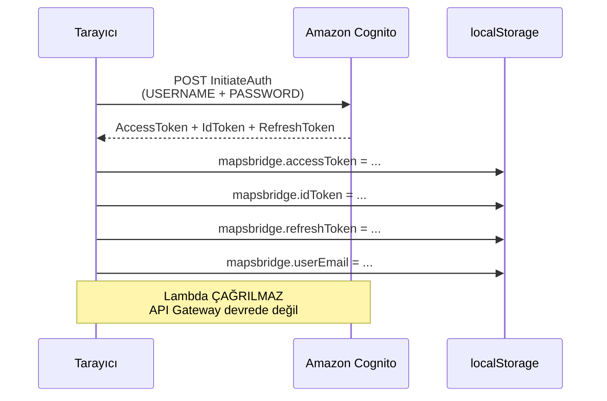
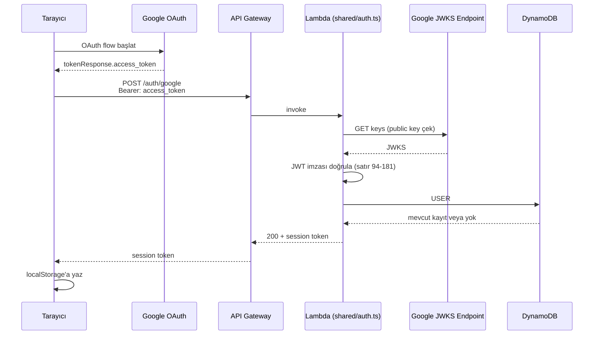
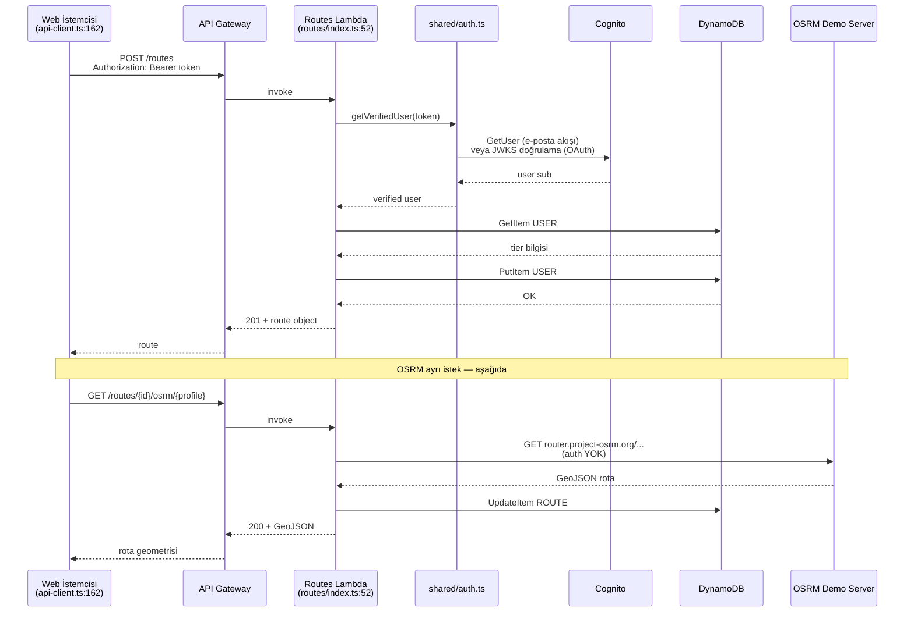
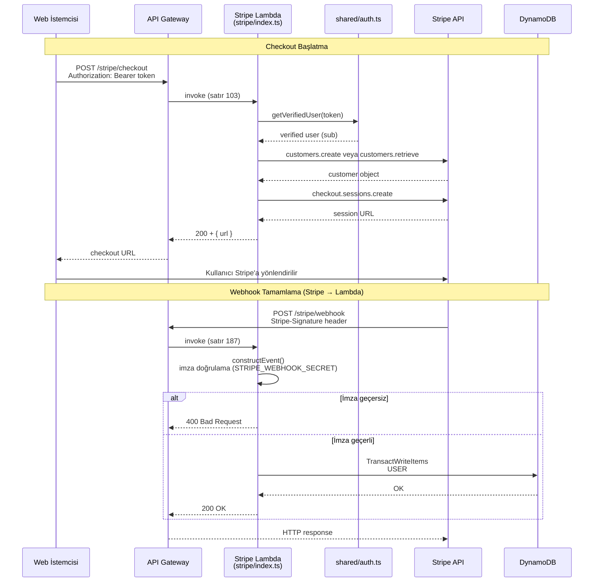

# MapsBridge — Mimari Belgesi

> **Not:** Bu belge kod tabanının statik analizinden üretilmiştir. `[doğrulanmadı]` etiketi, canlı ortamda elle onaylanmamış bilgileri işaretler.

---

## 1. Sistem Genel Bakış

### AWS Bölgesi ve Temel Stack

| Katman        | Teknoloji                  | Notlar                                                               |
| ------------- | -------------------------- | -------------------------------------------------------------------- |
| Bölge         | `eu-central-1` (Frankfurt) | Tüm servisler                                                        |
| API           | Amazon API Gateway         | ID: `pwi1j8mq0j`, endpoint: `execute-api.eu-central-1.amazonaws.com` |
| Hesaplama     | AWS Lambda (`nodejs22.x`)  | Serverless, per-route Lambda'lar                                     |
| Veritabanı    | Amazon DynamoDB            | Single-table design, tablo adı: `{env}-data`                         |
| Kimlik        | Amazon Cognito             | + Google/Apple OAuth JWKS doğrulama                                  |
| AI            | Amazon Bedrock             | [doğrulanmadı] model: Claude 3.5 Sonnet                              |
| Web frontend  | Next.js → S3 + CloudFront  | Statik export                                                        |
| Mobil         | Expo React Native          | EAS Build ile dağıtım                                                |
| Ödeme (web)   | Stripe                     | Checkout Sessions + Webhook                                          |
| Ödeme (mobil) | RevenueCat                 | [doğrulanmadı]                                                       |
| Rota motoru   | OSRM                       | `router.project-osrm.org` demo sunucusu — auth yok                   |

### Giriş Noktaları (Entrypoints)

```
Tarayıcı → CloudFront → S3 (Next.js)
           │
           └──→ API Gateway (pwi1j8mq0j) → Lambda fonksiyonları
                    │
                    └──→ Cognito (direkt, Lambda bypass)

Mobil    → API Gateway → Lambda fonksiyonları
           │
           └──→ RevenueCat (satın alma doğrulama) [doğrulanmadı]

Stripe   → POST /stripe/webhook → Lambda (imzalı)
```

---

## 2. Kritik Kullanıcı Senaryoları — İstek Akışı

### Senaryo 1 — Kullanıcı Girişi

**E-posta/şifre akışı:**

1. **Tarayıcı** `POST https://cognito-idp.eu-central-1.amazonaws.com/` — `InitiateAuth` action
2. **Cognito** token döner (AccessToken, IdToken, RefreshToken)
3. **Tarayıcı** token'ları `localStorage`'a yazar:
   - `mapsbridge.accessToken`
   - `mapsbridge.idToken`
   - `mapsbridge.refreshToken`
   - `mapsbridge.userEmail`

> **Önemli:** Bu akışta **Lambda çağrılmaz.** Tarayıcı ↔ Cognito arasında doğrudan HTTPS — API Gateway devrede değil.

**Google OAuth akışı:**

1. Tarayıcı Google OAuth flow'u tamamlar → `tokenResponse.access_token` alır
2. Bu token **API Gateway üzerinden** Lambda'ya iletilir
3. `infra/lambda/src/shared/auth.ts:94-181` — `getVerifiedUser()` içinde JWKS endpoint'ten Google public key çekilir, JWT imzası doğrulanır
4. Hesap birleştirme (account linking) aynı fonksiyon içinde gerçekleşir [doğrulanmadı — Apple için de aynı yol]

---

### Senaryo 2 — Rota Oluşturma

1. **Web istemcisi** `apps/web/app/lib/api-client.ts:162` → `apiFetch("/routes", { method: "POST", body: ... })`
2. **API Gateway** isteği `routes` Lambda'ya yönlendirir
3. **`infra/lambda/src/routes/index.ts:52`** — `handler()` başlar
   - `auth.ts:getVerifiedUser()` → Cognito `GetUser` (e-posta) veya JWKS doğrulama (Google/Apple) çağrısı
   - Tier kontrolü: DynamoDB'den `USER#{sub}/SUBSCRIPTION` kaydı okunur
   - Kota/kredi kontrolü [doğrulanmadı — senaryo bazlı]
4. **DynamoDB** `PutItem` → `PK: USER#{sub}`, `SK: ROUTE#{uuid}`
5. **Lambda** oluşturulan rota kaydını döner (OSRM henüz çağrılmaz)

**OSRM adımı (ayrı istek):**

- `GET /routes/{id}/osrm/{profile}` → Lambda → `router.project-osrm.org` (demo, **auth yok**, **rate limit yok** [doğrulanmadı])
- Sonuç DynamoDB'ye geri yazılır [doğrulanmadı]

---

### Senaryo 3 — Stripe Ödeme

**Checkout başlatma:**

1. İstemci `POST /stripe/checkout` gönderir (`Authorization: Bearer <token>`)
2. `infra/lambda/src/stripe/index.ts:103` — `getVerifiedUser()` çağrılır
3. Stripe `customers.create` veya mevcut müşteri `get`
4. `checkout.sessions.create` → Stripe URL'i döner → istemci yönlendirilir

**Webhook tamamlama:**

1. Stripe `POST /stripe/webhook` çağırır
2. `infra/lambda/src/stripe/index.ts:187` — `constructEvent()` ile **imza doğrulama** (`STRIPE_WEBHOOK_SECRET`)
3. İmza geçerliyse: DynamoDB `TransactWriteItems` (idempotency):
   - `USER#{sub}/SUBSCRIPTION` güncellenir
   - `BILLING#CHECKOUT#{id}/RECEIPT` oluşturulur (yeniden işleme engeli)

---

## 3. State — Nerede Tutuluyor?

### DynamoDB Ana Tablo: `{env}-data`

Single-table design. Bilinen key pattern'leri:

| PK                      | SK             | İçerik                               |
| ----------------------- | -------------- | ------------------------------------ |
| `USER#{sub}`            | `ROUTE#{uuid}` | Rota verisi                          |
| `USER#{sub}`            | `SUBSCRIPTION` | Abonelik tier, bitiş tarihi          |
| `USER#{sub}`            | `CREDITS`      | AI kredi bakiyesi                    |
| `BILLING#CHECKOUT#{id}` | `RECEIPT`      | Stripe idempotency kaydı             |
| `SYSTEM#CONFIG`         | `META`         | Sistem konfigürasyonu [doğrulanmadı] |

**GSI durumu:**

- `chat/index.ts:75-87` GSI1 kullanıyor **ancak Terraform tanımında GSI1 yok** → `GET /chat/threads` endpoint'i kırık [doğrulanmadı — canlı ortamda doğrulanmadı]

### In-Memory (Lambda Warm State)

| Dosya                                  | Nesne                      | Notlar                                                                 |
| -------------------------------------- | -------------------------- | ---------------------------------------------------------------------- |
| `infra/lambda/src/shared/dynamo.ts:4`  | `DynamoDBClient` singleton | Lambda container yeniden kullanıldığında tek instance                  |
| `infra/lambda/src/billing/store.ts:25` | `new DynamoDBClient()`     | **Her çağrıda yeni instance yaratıyor** — singleton değil, tutarsızlık |

### Browser (localStorage)

```
mapsbridge.accessToken
mapsbridge.idToken
mapsbridge.refreshToken
mapsbridge.userEmail
```

> Token'lar `localStorage`'da tutuluyor (httpOnly cookie değil). XSS riski mevcut [doğrulanmadı — Content Security Policy durumu bilinmiyor].

### Dış Servisler (Canonical Source of Truth)

| Servis           | Ne Tutuyor                                    |
| ---------------- | --------------------------------------------- |
| Cognito          | Kullanıcı kimliği, şifre hash, OAuth link     |
| Stripe           | Ödeme yöntemi, fatura geçmişi                 |
| RevenueCat       | Mobil abonelik durumu [doğrulanmadı]          |
| OSRM demo server | Hiçbir şey — stateless, rota hesaplama API'si |
| Bedrock          | Hiçbir şey — stateless inference              |

---

## 4. "Dokunursan Patlar" — 5 Kritik Yer

### 1. `billing/store.ts:110` — `reserveAI()` Kredi Atomikliği

DynamoDB `TransactWriteItems` ile kredi rezervasyonu yapılıyor. Bu işlem **tüm ödeme ve AI kullanım akışının kalbi.** Koşul ifadeleri (`ConditionExpression`) değiştirilirse ya da hata yönetimi bozulursa:

- Çift harcama (double-spend) oluşabilir
- Krediler negatife düşebilir
- Kullanıcılar ücret ödemeden sınırsız AI kullanabilir

**Kural:** Bu fonksiyona dokunmadan önce DynamoDB transactions semantiğini ve mevcut `ConditionExpression` koşullarını tam anla.

---

### 2. `shared/auth.ts:94-181` — Google/Apple JWKS Doğrulama + Hesap Birleştirme

E-posta/şifre, Google OAuth ve Apple Sign-In akışlarının birleştiği tek nokta. Yanlış değişiklik:

- Farklı provider'larla aynı e-postanın farklı hesaplara açılmasına neden olabilir (hesap bölünmesi)
- JWKS önbellek/yenileme mantığı bozulursa tüm OAuth girişleri başarısız olur
- Account linking silme/güncelleme hatası veri tutarsızlığı yaratır

**Kural:** Her değişiklik için e-posta+şifre, Google ve Apple ile uçtan uca giriş testleri yap.

---

### 3. `stripe/index.ts:187` — Webhook İmza Doğrulama + Idempotency

`constructEvent()` başarısız olursa abonelik hiç aktif olmaz. Idempotency mantığı bozulursa:

- Aynı webhook iki kez işlenip kullanıcıya iki abonelik yazılabilir
- Ya da webhook hiç işlenmeyip kullanıcı ödeme yaptığı halde erişim alamayabilir

**Kural:** `STRIPE_WEBHOOK_SECRET` ortam değişkeni production'da asla değiştirilmemelidir. Değişirse eski bekleyen webhook'lar başarısız olur.

---

### 4. `routes/index.ts:52-85` — Auth Middleware Zinciri

Lambda handler'ın ilk ~33 satırı auth, tier kontrolü ve kota doğrulamasını sırayla çalıştırıyor. Sıra değişirse ya da bir adım atlanırsa:

- Yetkisiz kullanıcılar rota oluşturabilir
- Free tier kullanıcılar paid özelliklerine erişebilir
- Kota kontrolü bypass edilebilir

**Kural:** Middleware sıralamasını değiştirme. Yeni kontrol eklemek gerekiyorsa zincirin sonuna ekle ve her tier için test yaz.

---

### 5. DynamoDB GSI1 Eksikliği — `chat/index.ts:75-87`

`GET /chat/threads` endpoint'i GSI1 üzerinden sorgu yapıyor ancak bu index Terraform tanımında yok. Sonuç: endpoint şu an kırık ya da yanlış sonuç dönüyor [doğrulanmadı].

**Tehlike:** Terraform'da GSI eklemek DynamoDB tablosunu yeniden oluşturmaz ama production'da GSI provisioning süresi boyunca tablo performansı düşer. `BillingMode` PAY_PER_REQUEST ise sorun daha az, provisioned ise dikkatli ol. Mevcut veri varsa backfill gerekebilir.

**Kural:** GSI eklemeden önce: 1) tablonun mevcut item sayısını kontrol et, 2) staging'de uygula, 3) GSI backfill tamamlanana kadar chat endpoint'i canlıya alma.

---

## 5. Sequence Diyagramları

### Senaryo 1 — Kullanıcı Girişi (E-posta/Şifre)



---

### Senaryo 1 — Kullanıcı Girişi (Google OAuth)



---

### Senaryo 2 — Rota Oluşturma



---

### Senaryo 3 — Stripe Ödeme



---

_Son güncelleme: Kod tabanı statik analizi ile üretildi. Canlı ortam doğrulaması için `[doğrulanmadı]` etiketli kısımları elle test edin._
