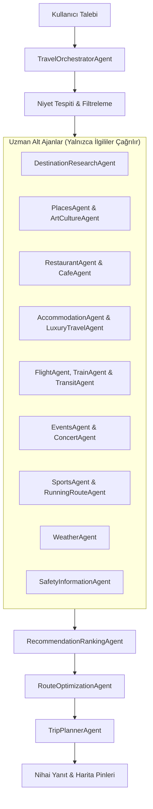

# AGENTS.md — Multi-Agent Mimarisi & Uzman Ajan Şartnamesi

Bu belge, MapsBridge platformundaki **TravelOrchestratorAgent** ana koordinatörünü ve kullanıcının isteklerine göre dinamik olarak seçilip paralel çalıştırılan **25 uzman alt ajanı** tanımlar.

---

## 1. Multi-Agent Mimari Vizyonu

Monolitik, her şeyi tek promptta çözmeye çalışan devasa modeller yerine; sorumlulukları açıkça ayrılmış, kendi uzmanlık alanında derinleşen mikro-ajanlar kullanılır:



---

## 2. 25 Uzman Ajan Envanteri ve Sorumlulukları

| Ajan Adı | Rolü ve Görevi | Girdi Parametreleri | Çıktı Modeli |
|---|---|---|---|
| **1. TravelOrchestratorAgent** | Ana orkestratör; diyalog akışını, niyet analizini ve alt ajan koordinasyonunu yönetir. | `prompt`, `history`, `profile` | `OrchestratorPlan` |
| **2. DestinationResearchAgent** | Şehrin genel karakteristiği, en uygun ziyaret mevsimi, vize ve para birimi bilgisi. | `destination` | `DestinationIntel` |
| **3. PlacesAgent** | Tarihi merkezler, simge anıtlar, seyir terasları ve mimari yapılar. | `city`, `interests`, `limit` | `Place[]` |
| **4. RestaurantAgent** | Yerel mutfak durakları, otantik trattoria'lar, akşam yemeği mekanları. | `city`, `diet`, `budget` | `Restaurant[]` |
| **5. CafeAgent** | Specialty üçüncü nesil kahveciler, çalışma kafeleri, tarihi fırın ve tatlıcılar. | `city`, `lat/lng` | `Cafe[]` |
| **6. AccommodationAgent** | Merkezi, güvenli semtlerdeki oteller, pansiyonlar ve daireler. | `city`, `dates`, `budget` | `HotelDeal[]` |
| **7. FlightAgent** | Havalimanı aktarma süreleri, uçuş rotaları ve partner yönlendirmeleri. | `origin`, `destination`, `dates` | `FlightOption[]` |
| **8. TrainAgent** | Şehirlerarası hızlı tren hatları (TGV, Frecciarossa vb.), biletleme bilgisi. | `fromCity`, `toCity`, `date` | `TrainOption[]` |
| **9. BusAgent** | Bölgesel otobüs seferleri, ekonomik aktarmalar. | `fromCity`, `toCity` | `BusOption[]` |
| **10. PublicTransportAgent** | Şehir içi metro haritası, bilet/kart türleri, otobüs hatları. | `city`, `fromCoord`, `toCoord` | `TransitGuide` |
| **11. EventsAgent** | Seyahat tarihlerindeki festivaller, sergiler, fuarlar ve yerel şenlikler. | `city`, `dateRange` | `Event[]` |
| **12. ConcertAgent** | Müzik etkinlikleri, canlı performanslar, opera ve tiyatro gösterileri. | `city`, `dateRange`, `genre` | `Concert[]` |
| **13. ArtCultureAgent** | Modern sanat galerileri, paha biçilmez müzeler, heykel ve fresk merkezleri. | `city`, `interests` | `ArtVenue[]` |
| **14. NightlifeAgent** | Kokteyl barları, canlı müzik mekanları, caz kulüpleri ve gece kulüpleri. | `city`, `neighborhood` | `NightlifeVenue[]` |
| **15. SportsAgent** | Şehirdeki spor salonları, yüzme havuzları, bisiklet kiralama noktaları. | `city`, `sportType` | `SportsVenue[]` |
| **16. RunningRouteAgent** | Güvenli sabah koşu rotaları, deniz kenarı parkurları, zemin ve eğim analizi. | `city`, `distanceKm`, `timeOfDay` | `RunningTrack` |
| **17. WeatherAgent** | 3-7 günlük hava tahmini, yağmur olasılığı, açık/kapalı mekan uyarısı. | `city`, `dates` | `WeatherForecast` |
| **18. RouteOptimizationAgent** | Duraklar arası mesafeyi en aza indiren coğrafi kümeleme (clustering) ve sıralama. | `stops[]`, `transportMode` | `OptimizedRoute` |
| **19. BudgetAgent** | Seyahat bütçesi dökümü (konaklama, yemek, biletler, ulaşım) ve tasarruf ipuçları. | `tripDuration`, `targetBudget` | `BudgetBreakdown` |
| **20. LuxuryTravelAgent** | Özel rehberli turlar, Michelin yıldızlı restoranlar, helikopter/VIP transferler. | `city`, `preferences` | `LuxuryExperience[]` |
| **21. LocalExperienceAgent** | Turist kalabalıklarından uzak, yalnızca yerlilerin bildiği gizli deneyimler. | `city`, `neighborhood` | `LocalGem[]` |
| **22. SafetyInformationAgent** | 112/911 acil hatları, Türk Konsoloslukları, güvenli/riskli mahalle uyarıları. | `city`, `country` | `EmergencyInfo` |
| **23. TripPlannerAgent** | Tüm alt ajan çıktılarından gün gün, saat saat dengeli bir seyahat programı sentezler. | `subAgentResults[]` | `UnifiedRoutePlan` |
| **24. RecommendationRankingAgent**| Kullanıcı tercih puanına ve hava uyumuna göre aday önerileri sıralar. | `candidates[]`, `profile` | `RankedList[]` |
| **25. DataVerificationAgent** | Önerilen mekanların açık olup olmadığını, çalışma saatlerini ve koordinatlarını denetler. | `places[]` | `VerifiedPlace[]` |

---

## 3. Dinamik Niyet Yönlendirme (Intent Routing)

Her kullanıcı mesajında tüm 25 ajanı çağırmak **FinOps ve gecikme (latency) açısından kesinlikle yasaktır**.

```typescript
export function resolveSpecialistAgents(intent: string, prompt: string): string[] {
  const norm = prompt.toLocaleLowerCase('tr');
  const selected: string[] = [];

  // Koşu ve Spor
  if (/koşu|koşmak|parkur|jogging|bisiklet|fitness/iu.test(norm)) {
    selected.push('RunningRouteAgent', 'SportsAgent', 'WeatherAgent');
  }

  // Yeme & İçme
  if (/yemek|restoran|kahve|kafe|tatlı|lezzet|gurme|kahvaltı/iu.test(norm)) {
    selected.push('RestaurantAgent', 'CafeAgent', 'LocalExperienceAgent');
  }

  // Kültür, Sanat & Müzeler
  if (/müze|sanat|sergi|galeri|tarih|antik/iu.test(norm)) {
    selected.push('PlacesAgent', 'ArtCultureAgent', 'EventsAgent');
  }

  // Konser & Gece Hayatı
  if (/konser|etkinlik|gece|bar|kulüp|canlı müzik/iu.test(norm)) {
    selected.push('ConcertAgent', 'NightlifeAgent', 'EventsAgent');
  }

  // Ulaşım & Aktarma
  if (/uçak|uçuş|tren|otobüs|nasıl giderim|ulaşım|metro/iu.test(norm)) {
    selected.push('PublicTransportAgent', 'FlightAgent', 'TrainAgent');
  }

  // Acil Durum & Güvenlik
  if (/acil|yardım|hastane|polis|doktor|güvenlik|pasaport/iu.test(norm)) {
    selected.push('SafetyInformationAgent');
  }

  // Kapsamlı Rota İsteğinde temel planlayıcılar daima eklenir
  if (selected.length === 0 || /rota|plan|günlük/iu.test(norm)) {
    selected.push('PlacesAgent', 'RestaurantAgent', 'WeatherAgent', 'RouteOptimizationAgent', 'TripPlannerAgent');
  }

  return [...new Set(selected)];
}
```

---

## 4. Paralel Çalıştırma Modeli (Concurrent Execution)

Bağımsız alt ajanlar `Promise.allSettled` mekanizmasıyla paralel tetiklenir:
- Bir ajanın zaman aşımına uğraması (timeout) tüm yanıtı çökertmez.
- Başarılı olan ajanların verileri `RecommendationRankingAgent` tarafından birleştirilir.
- Kullanıcıya ortalama **< 1.5 saniye** içinde zengin kartlar ve doğal dil cevabı iletilir.
