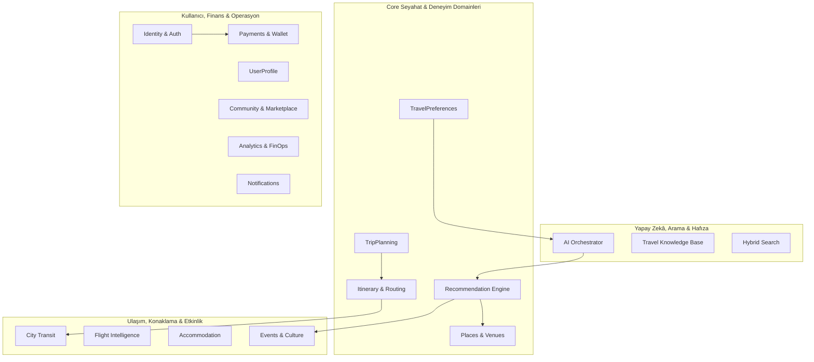

# DOMAIN_MAP.md — 18 Bounded Context ve Domain Sınırları Şartnamesi

Bu belge, MapsBridge AI-First Seyahat Platformu'nun 18 temel domain modülünü, Aggregate Root'larını, Değer Nesnelerini (Value Objects), Domain Olaylarını (Events) ve değişmez kurallarını (Invariants) tanımlar.

---

## 1. Domain Haritası ve Bounded Context Matrisi

---

## 2. 18 Bounded Context Detayları

### 1. Identity Context
- **Sorumluluk:** Cognito User Pool JWT doğrulama, kullanıcı kimliği (`userId`), rol tabanlı yetki denetimi (RBAC: `user`, `support`, `moderator`, `admin`).
- **Aggregate Root:** `AccountIdentity`
- **Value Objects:** `CognitoSub`, `UserRole`, `AuthToken`
- **Events:** `UserAuthenticatedEvent`, `AccountSuspendedEvent`
- **Invariants:** Askıya alınmış veya e-postası doğrulanmamış hesaplar yazma veya AI işlemlerini tetikleyemez.

### 2. UserProfile Context
- **Sorumluluk:** Kullanıcı profil detayları, takma ad (`username`), biyografi, ziyaret edilen ülkeler listesi, avatar ve kapak fotoğrafları.
- **Aggregate Root:** `UserProfile`
- **Value Objects:** `Username`, `CountryCode`, `SocialLinks`
- **Events:** `ProfileUpdatedEvent`, `ProfilePublishedEvent`
- **Invariants:** Kullanıcı adı 3–30 karakter, küçük harf ve alfanümerik olmalıdır. Bir kullanıcı adı yalnızca bir hesaba bağlanabilir.

### 3. TravelPreferences Context
- **Sorumluluk:** Kullanıcının seyahat tarzı, bütçe eğilimi, yürüyüş toleransı, diyet kısıtlamaları (vegan, vejetaryen, helal, koşer, glütensiz), sevilen/sevilmeyen aktivite türleri.
- **Aggregate Root:** `TravelPreferencesProfile`
- **Value Objects:** `PacePreference` (`relaxed`, `balanced`, `intensive`), `BudgetLevel` (`budget`, `standard`, `premium`, `luxury`), `DietaryRestriction`, `MobilityPreference`.
- **Events:** `PreferencesUpdatedEvent`, `PreferenceLearnedByAIEvent`
- **Invariants:** Kullanıcı öğrendiği her tercihi şeffaf olarak görüntüleyebilir, düzenleyebilir veya sıfırlayabilir (`ForgetPreferences`).

### 4. TripPlanning Context
- **Sorumluluk:** Çok günlük seyahat planları, seyahat adı, hedef şehir, seyahat tarihleri, yolcu sayısı (yetişkin, çocuk, evcil hayvan).
- **Aggregate Root:** `Trip`
- **Value Objects:** `TripId`, `Destination`, `DateRange`, `TravelerGroup`
- **Events:** `TripCreatedEvent`, `TripDestinationChangedEvent`, `TripArchivedEvent`
- **Invariants:** Seyahat süresi minimum 1 gün, maksimum 30 gündür. Bir seyahatin hedefi boş olamaz.

### 5. Places Context
- **Sorumluluk:** Turistik yerler, müzeler, tarihi anıtlar, parklar, plajlar, fotoğraf noktaları ve mekan metadata'ları.
- **Aggregate Root:** `Place`
- **Entities:** `PlaceReview`, `OpeningHoursSchedule`
- **Value Objects:** `Coordinate` (enlem: -90/+90, boylam: -180/+180), `PlaceCategory`, `ConfidenceScore`
- **Events:** `PlaceVerifiedEvent`, `PlaceHoursUpdatedEvent`
- **Invariants:** Koordinatları geçersiz olan hiçbir mekan kaydedilemez.

### 6. Recommendations Context
- **Sorumluluk:** Kullanıcı tercihleri, lokasyon, günün saati, hava durumu ve bütçeye göre kişiselleştirilmiş mekan ve deneyim skorlaması.
- **Aggregate Root:** `RecommendationSession`
- **Value Objects:** `ScoringWeights`, `CandidateScore` (0.0 - 1.0)
- **Events:** `RecommendationsGeneratedEvent`, `RecommendationAcceptedEvent`
- **Invariants:** Öneriler asla kapalı veya hava koşullarına tehlikeli açık hava mekanlarını içermemelidir.

### 7. Itinerary Context
- **Sorumluluk:** Günlük duraklar (`Stop`), duraklar arası mesafe ve süre matrisi, OSRM rota geometrisi, zaman slotları (`morning`, `lunch`, `afternoon`, `evening`, `night`).
- **Aggregate Root:** `ItineraryDay`
- **Entities:** `RouteStop`
- **Value Objects:** `TimeSlot`, `EstimatedDurationMinutes`, `TransitLeg`
- **Events:** `StopAddedEvent`, `StopReorderedEvent`, `DayOptimizedEvent`
- **Invariants:** Bir günün toplam program süresi fizibilite gereği 8.5 saati aştığında kullanıcıya `heavy_day` uyarısı verilmelidir.

### 8. Transportation Context
- **Sorumluluk:** Şehir içi toplu taşıma, metro hatları, otobüs, tramvay, taksi, paylaşımlı araç ve yürüme sürelerinin karşılaştırılması.
- **Aggregate Root:** `TransitRouteComparison`
- **Value Objects:** `TransitMode` (`walk`, `metro`, `bus`, `tram`, `taxi`, `bike`, `ferry`), `FareEstimate`
- **Events:** `TransitDirectionsCalculatedEvent`
- **Invariants:** Yürüme süresi 20 dakikadan az ve hava uygunsa yürüyüş seçeneği önceliklendirilir.

### 9. Flights Context
- **Sorumluluk:** Havalimanı transferleri, uçuş arama parametreleri, aktarmalar, kabin sınıfı, bagaj kuralları ve partner rezervasyon yönlendirmeleri.
- **Aggregate Root:** `FlightSearchQuery`
- **Value Objects:** `IataCode`, `CabinClass` (`economy`, `premium_economy`, `business`, `first`), `FlightOffer`
- **Events:** `FlightDealsFoundEvent`
- **Invariants:** Platform doğrudan bilet kesmez; kullanıcıyı yetkili havayolu veya partner bağlantısına yönlendirir.

### 10. Accommodation Context
- **Sorumluluk:** Oteller, butik pansiyonlar, hostel'ler, semt güvenliği, merkezilik ve toplu taşımaya yakınlık skorları.
- **Aggregate Root:** `LodgingOption`
- **Value Objects:** `PriceTier`, `NeighborhoodSafetyScore`, `TransitDistanceScore`
- **Events:** `HotelDealMatchedEvent`
- **Invariants:** Gürültüye duyarlı kullanıcılar için gece kulübü yoğunluğu yüksek semt otellerine otomatik uyarı eklenir.

### 11. Events Context
- **Sorumluluk:** Konserler, festivaller, sergiler, tiyatro, spor müsabakaları ve yerel gastronomi günleri.
- **Aggregate Root:** `TravelEvent`
- **Value Objects:** `EventDateTime`, `EventCategory`, `TicketAvailability`
- **Events:** `EventSyncedEvent`, `EventScheduleMatchedEvent`
- **Invariants:** Etkinlik tarihleri kullanıcının seyahat tarihleri ile kesişmek zorundadır.

### 12. Community Context
- **Sorumluluk:** Herkese açık gezgin rotaları, seyahat yazıları, blog makaleleri, topluluk beğenileri ve takip sistemi.
- **Aggregate Root:** `CommunityRoute`
- **Entities:** `CommunityArticle`, `Comment`
- **Value Objects:** `LikeCount`, `ForkCount`
- **Events:** `RouteSharedToCommunityEvent`, `ArticlePublishedEvent`
- **Invariants:** Askıya alınmış veya özel (private) rotalar pazaryerinde listelenemez.

### 13. AI Context
- **Sorumluluk:** Niyet tespiti, soru orkestrasyonu, alt ajan koordinasyonu, prompt-injection denetimi, seyahat kapsam kalkanı ve streaming yanıtlar.
- **Aggregate Root:** `AIConversationSession`
- **Entities:** `SubAgentExecution`
- **Value Objects:** `IntentAction`, `PromptVersion`, `SafetyStatus`
- **Events:** `AIRequestDispatchedEvent`, `GuardrailViolationInterceptedEvent`
- **Invariants:** Seyahat dışı sorular kesinlikle engellenir ve 0 kredi harcanır.

### 14. Knowledge Context
- **Sorumluluk:** Vektör embedding'leri, doğrulanmış seyahat dokümanları, mekan çalışma saatleri ve TTL yaşam döngüsü yönetimi.
- **Aggregate Root:** `KnowledgeDocument`
- **Value Objects:** `DocumentHash`, `EmbeddingVector`, `TtlExpiry`
- **Events:** `KnowledgeSyncedEvent`, `KnowledgeExpiredEvent`
- **Invariants:** Süresi geçmiş (expired) veya onaylanmamış (unreviewed) dokümanlar LLM bağlamına verilemez.

### 15. Search Context
- **Sorumluluk:** Hibrit Arama motoru (Anahtar Kelime + Vektör Semantik + Coğrafi Yarıçap Filtresi).
- **Aggregate Root:** `SearchQuery`
- **Value Objects:** `GeoBoundingBox`, `SearchFilter`
- **Events:** `SearchExecutedEvent`
- **Invariants:** Coğrafi mesafe sınırları dışındaki adaylar ilk filtreleme aşamasında elenir.

### 16. Payments Context
- **Sorumluluk:** Kredi cüzdanı, Stripe Checkout oturumları, webhook imza doğrulaması, atomik kredi rezervasyonu ve iadesi.
- **Aggregate Root:** `CreditWallet`
- **Entities:** `CreditTransaction`, `StripeReceipt`
- **Value Objects:** `CreditAmount`, `Currency`, `IdempotencyKey`
- **Events:** `CreditsReservedEvent`, `CreditsSettledEvent`, `CreditsRefundedEvent`
- **Invariants:** Bakiye asla sıfırın altına düşemez. Aynı idempotency anahtarıyla mükerrer kredi yüklenemez.

### 17. Analytics Context
- **Sorumluluk:** FinOps token maliyeti takibi, model bazlı harcama hesaplaması, kullanıcı etkileşim izleme ve SLO metrikleri.
- **Aggregate Root:** `UsageMetric`
- **Value Objects:** `TokenCount`, `EstimatedCostUsd`, `LatencyMs`
- **Events:** `CostRecordedEvent`, `SloBreachDetectedEvent`
- **Invariants:** Her AI isteğinin token ve tahmini maliyet kaydı tutulmalıdır.

### 18. Notifications Context
- **Sorumluluk:** Yaklaşan rota uyarıları, hava durumu değişiklik bildirimleri, bütçe eşiği alarmları ve sistem duyuruları.
- **Aggregate Root:** `UserNotification`
- **Value Objects:** `NotificationType`, `PriorityLevel`
- **Events:** `NotificationSentEvent`, `NotificationReadEvent`
- **Invariants:** Kullanıcı izni olmadan arka planda istenmeyen bildirim gönderilemez.
