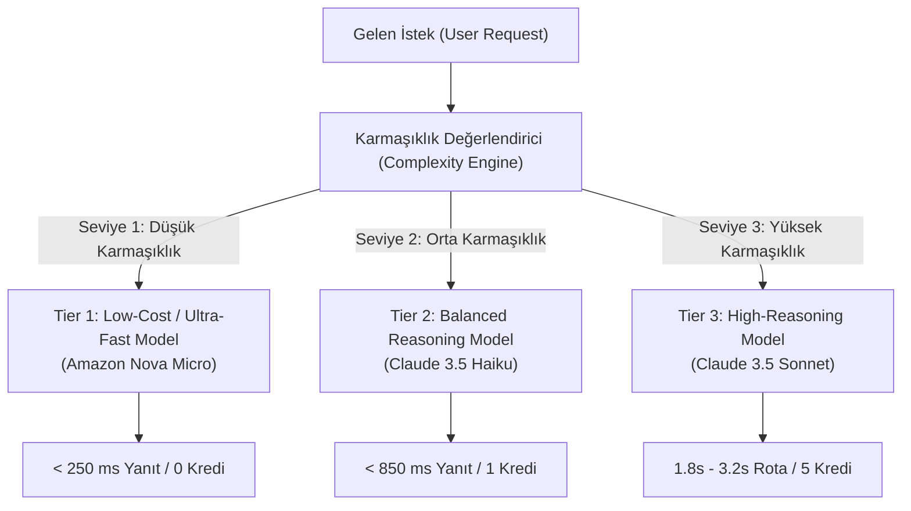

# MODEL_ROUTING.md — Çok Katmanlı Model Yönlendirme (Model Router) Şartnamesi

Bu belge, MapsBridge platformundaki dinamik model seçim stratejisini, görev karmaşıklığına (complexity) dayalı otomatik yönlendirme kurallarını ve maliyet-performans optimizasyonunu tanımlar.

---

## 1. Model Router Vizyonu

Her kullanıcı isteği için (örneğin basit bir "Merhaba", bir restoran önerisi veya bir semt sorusu için) Claude 3.5 Sonnet veya GPT-4 gibi pahalı ve yavaş akıl yürütme modellerini çalıştırmak **FinOps açısından kabul edilemez bir israftır**.

MapsBridge, istek karmaşıklığını 3 kademede değerlendiren akıllı bir **Model Router** kullanır:



---

## 2. 3 Katmanlı Model Matrisi ve Rol Dağılımı

| Model Katmanı | Tercih Edilen Model | Kullanım Alanları | Gecikme (Latency) | Token Maliyeti |
|---|---|---|---|---|
| **Tier 1: Ultra-Fast Intake & Classification** | `eu.amazon.nova-micro-v1:0` | • Niyet Sınıflandırma (Intent Routing)<br/>• Varlık Çıkarımı (Entity Extraction)<br/>• Güvenlik & PII Kalkanı Denetimi<br/>• Kısa Karşılama ve Netleştirme Soruları<br/>• Arama Sorgusu Yeniden Yazımı (Query Rewriting) | **< 250 ms** | **~$0.000035 / 1K token** |
| **Tier 2: Interactive Travel Dialogue** | `eu.anthropic.claude-haiku-4-5-20251001-v1:0` | • Doğal Dil Seyahat Sohbeti<br/>• Restoran, Kafe ve Müze Önerileri<br/>• Tek Günlük Gezi Planı ve Yürüyüş Rotaları<br/>• Alt Ajan (Sub-Agent) Tool Çağrıları | **< 850 ms** | **~$0.001 / 1K token** |
| **Tier 3: Deep Itinerary & Spatial Reasoning** | `eu.anthropic.claude-3-5-sonnet-20241022-v2:0` | • Çok Günlük ve Çok Şehirli Karmaşık Rotalar<br/>• Katı Zaman ve Bütçe Kısıtlarının Çözümü<br/>• Dinamik Rota Yeniden Planlama (Replanning)<br/>• Coğrafi Çapraz Kümeleme ve Fizibilite | **1.8 s – 3.2 s** | **~$0.015 / 1K token** |

---

## 3. Otomatik Karmaşıklık Değerlendirme Algoritması (Complexity Scoring)

Model Router, isteğin karmaşıklık puanını (0 - 100) aşağıdaki faktörlerle hesaplar:

```typescript
export function calculateRequestComplexity(payload: {
  prompt: string;
  hasExistingRoute: boolean;
  dayCount?: number;
  multiCity: boolean;
  activeConstraintsCount: number;
}): "tier1" | "tier2" | "tier3" {
  let score = 0;

  // 1. Çok şehir veya çok gün
  if (payload.multiCity) score += 40;
  if ((payload.dayCount || 1) >= 4) score += 30;
  else if ((payload.dayCount || 1) > 1) score += 15;

  // 2. Kısıt yoğunluğu (örn: bütçe + vegan + çocuklu + yağmur alternatifi)
  score += payload.activeConstraintsCount * 10;

  // 3. Yeniden planlama veya optimizasyon
  if (payload.hasExistingRoute && /değiştir|yeniden|optimize|uymadı|geç kaldım/iu.test(payload.prompt)) {
    score += 35;
  }

  // Yönlendirme Eşikleri
  if (score >= 60) return "tier3"; // Yüksek Akıl Yürütme (Sonnet)
  if (score >= 20) return "tier2"; // Dengeli Sohbet ve Tool Ajanları (Haiku)
  return "tier1";                  // Hızlı Giriş ve Sınıflandırma (Nova Micro)
}
```

---

## 4. Bölgesel Yedeklilik ve Yük Dengeleme (Cross-Region Resiliency)

AWS Bedrock üzerindeki model kotalarını veya bölgesel kesintileri yönetmek için dinamik fallback devrededir:
1. **Birincil Bölge:** `eu-central-1` (Frankfurt) — Düşük ağ gecikmesi.
2. **Yedek Bölge:** `eu-west-1` (İrlanda) — Frankfurt'ta kota aşımı veya 5xx hatası oluşursa 300 ms içinde otomatik yönlendirme yapılır.
3. **Graceful Degradation:** Sonnet modeli ulaşılamaz olduğunda rota üretimi durdurulmaz; Haiku modeli daha agresif sistem talimatlarıyla yedek planlayıcı olarak devreye girer.
