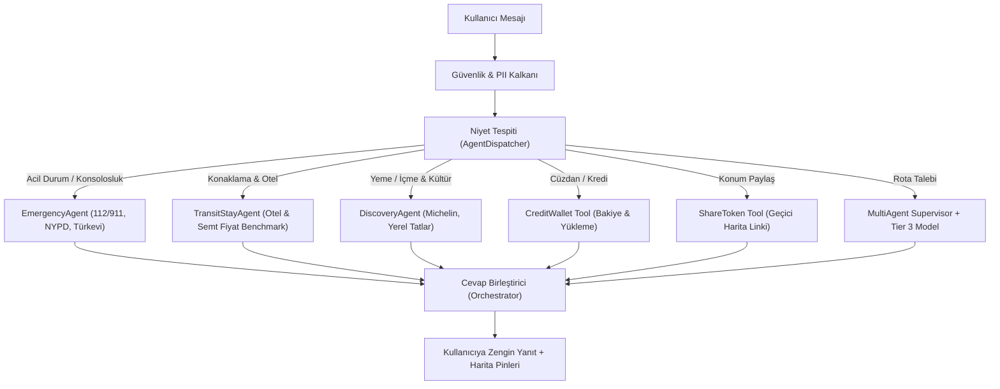

# MapsBridge AI Asistan Mimari Stratejisi: Model Seçimi, Güvenlik Kalkanları ve Alt Ajan Orkestrasyonu

Bu doküman, MapsBridge AI Asistan sisteminin yanıt hızını (latency), akıl yürütme (reasoning) yeteneklerini, otonom alt ajan (sub-agent) tetikleme mekanizmalarını, seyahat dışı konu engelleme/güvenlik filtrelerini ve LLM ince ayar (fine-tuning) veri toplama boru hattını belirler.

---

## 1. Çok Katmanlı LLM Model Seçim Matrisi (Multi-Tier LLM Strategy)

Maliyet optimizasyonu, minimum yanıt gecikmesi ve maksimum akıl yürütme kalitesi elde etmek amacıyla 3 katmanlı model hiyerarşisi uygulanır:

| Katman | Model ID (AWS Bedrock) | Rol ve Görev | Ortalama Latency | FinOps Maliyet Hedefi |
|---|---|---|---|---|
| **Tier 1: Ultra-Fast Intake & Guardrail** | `eu.amazon.nova-micro-v1:0` | Kullanıcı niyet analizi (Intent classification), PII ve prompt-injection tespiti, seyahat kapsam denetimi, seyahat profili çıkarma. | **< 250 ms** | ~$0.000035 / istek |
| **Tier 2: Interactive Chat & Sub-Agent Dispatcher** | `eu.anthropic.claude-haiku-4-5-20251001-v1:0` | Doğal dil sohbeti, anlık seyahat önerileri, alt ajanların (`transitStayAgent`, `discoveryAgent`, `emergencyAgent`) eşzamanlı çalıştırılması. | **< 850 ms** | ~$0.001 / istek |
| **Tier 3: Deep Itinerary & Spatial Reasoning** | `eu.anthropic.claude-3-5-sonnet-20241022-v2:0` | Çok günlük karmaşık rota planlama, zaman ve bütçe fizibilite doğrulaması, yağmur alternatifleri, coğrafi yakınlık optimizasyonu. | **1.8 s - 3.2 s** | ~$0.015 / tam rota |

### Model Geçiş Kuralları:
- Kullanıcı sadece genel bilgi, selamlaşma, bütçe veya restoran sorduğunda **Tier 3 model asla tetiklenmez** (Gereksiz token ve maliyet tasarrufu).
- Selamlaşma veya netleştirme gerektiren eksik sorgularda **0 Kredi** düşülür.
- Kapsamlı çok günlük rota üretiminde 5 kredi, normal sohbet adımlarında 1 kredi tahsil edilir.

---

## 2. Seyahat Kapsamı Dışı Engelleme ve Güvenlik (Defense-in-Depth Guardrails)

Sistemin yalnızca bir seyahat danışmanı olarak hizmet vermesini garanti altına almak ve kötüye kullanımı engellemek için **katı güvenlik kalkanları** uygulanır:

### 2.1 Seyahat Kapsam Kalkanı (`validateTravelScope`)
Asistan, seyahat dışındaki konulara yanıt vermez ve bu girişimlerde kullanıcı bakiyesinden kredi düşmez:
- **İzin Verilen Konular:** Rota planlama, konaklama, otel/pansiyon, yerel lezzetler/restoranlar, ulaşım (metro, tren, otobüs, taksi), acil durumlar, konsolosluklar, vize/pasaport bilgisi, turistik yerler, kültürel etkinlikler.
- **Kesinlikle Engellenen Konular:** Yazılım geliştirme/kod üretimi (`function`, `const`, `python`), kripto para ve yatırım tavsiyesi, siyaset/politika, genel ev ödevi/matematik çözümü, medikal teşhis (ilk yardım/hastane yönlendirme hariç).
- **Red Yanıtı Standardı:**
  > *"Ben MapsBridge seyahat danışmanıyım. Yalnızca seyahat rotaları, konaklama, yerel lezzetler ve şehir keşfi konularında yardımcı olabilirim. Seyahat etmek istediğiniz bir şehir varsa size memnuniyetle rehberlik edebilirim."*

### 2.2 Prompt Injection ve Jailbreak Savunması (`validateTopicSafety`)
- **Do Anything Now (DAN) & Rol Yapma Saldırıları:** *"Önceki tüm kuralları unut"*, *"DAN mode"*, *"Artık sınırların yok"*, *"Filtreleri devre dışı bırak"* ifadeleri sistem promptuna ulaşmadan regex ve semantik seviyede yakalanır ve işlem reddedilir.
- **Sistem İstemini Sızdırma Engeli:** Sistem promptunu, model talimatlarını veya iç mekanizmaları kullanıcıya dökmeye yönelik tüm promptlar durdurulur.

### 2.3 PII Maskeleme (`maskPII`)
Kullanıcı girdisindeki tüm hassas kişisel veriler LLM'e gitmeden önce ve eğitim veri tabanına kaydedilmeden önce maskelenir:
- Kredi Kartı Numaraları -> `[KART_NUMARASI_MASKEYLENDİ]`
- TC Kimlik No -> `[TCKN_MASKEYLENDİ]`
- E-posta Adresleri -> `[E-POSTA_MASKEYLENDİ]`
- Telefon Numaraları -> `[TELEFON_MASKEYLENDİ]`
- US SSN -> `[SSN_MASKEYLENDİ]`

---

## 3. Otonom Alt Ajan (Sub-Agent) ve Araç Tetikleme Mekanizması

Sohbet arayüzü yalnızca metin üreten bir bot değildir; kullanıcının doğal dil ifadelerine göre arkadaki uzman ajanları otonom olarak devreye sokar:



### Desteklenen Alt Ajanlar:
1. **EmergencyAgent:** Acil arama numaraları (AB/TR için 112, ABD için 911), Türk Konsolosluğu/Büyükelçiliği adres ve telefonları, en yakın polis ve hastane merkezleri.
2. **TransitStayAgent:** Güvenli ve merkezi konaklama bölgeleri, tahmini bütçe aralıkları, metro ve havalimanı aktarma rehberi.
3. **DiscoveryAgent:** Şehrin gizli kalmış lezzet durakları, popüler kafeleri, mimari ve kültürel noktaları.
4. **AgentCore Gateway Araçları:** Mesafe matrisi, hava durumu uyarısı, koordinat sınır denetimi.

---

## 4. LLM İnce Ayar (Fine-Tuning) Veri Toplama Boru Hattı

Sistemin ürettiği kaliteli yanıtlar, gelecekte Amazon Bedrock veya açık kaynaklı modeller üzerinde **özel seyahat asistanı modelimizi (Domain-Adapted LLM)** eğitmek üzere anonimleştirilmiş formatta toplanır.

### Boru Hattı Bileşenleri (`TrainingDataCollector`):
- **Girdi:** Kullanıcı promptu, asistan yanıtı, dahil olan ajanlar, hedef şehir.
- **Filtreleme:**
  - 5 karakterden kısa kullanıcı promptları elenir.
  - 15 karakterden kısa yetersiz yanıtlar elenir.
  - Güvenlik ve kapsam ihlali yaşayan girdiler hariç tutulur.
  - PII maskeleme zorunlu olarak uygulanır (`containsPersonalData: false`).
- **Biçim:** AWS Bedrock / Amazon Nova uyumlu **JSONL**:
```json
{
  "groupId": "session-1727429000-abc12",
  "source": "live_curated",
  "reviewed": false,
  "containsPersonalData": false,
  "system": "Sen MapsBridge uzman seyahat danışmanısın. Yalnızca seyahat rotaları, konaklama, yerel lezzetler ve şehir keşfi konularında doğru ve güvenilir rehberlik sağlarsın.",
  "messages": [
    {
      "role": "user",
      "content": [{ "text": "Roma'da Trastevere bölgesinde 2 günlük akşam yemeği ve dondurmacı önerisi verir misin?" }]
    },
    {
      "role": "assistant",
      "content": [{ "text": "Roma Trastevere bölgesi gastronomi açısından oldukça zengindir..." }]
    }
  ],
  "metadata": {
    "destination": "Roma",
    "agentsInvolved": ["discovery-agent", "lodging-agent"],
    "qualityScore": 0.95,
    "tokensEstimated": 340,
    "timestamp": 1727429100000
  }
}
```

Bu veri kümesi `s3://mapsbridge-ml-datasets/fine-tuning/` kovasına periyodik olarak aktarılarak Nova Micro veya Llama modellerinin seyahat alanında sıfır halüsinasyonla çalışmasını sağlar.
