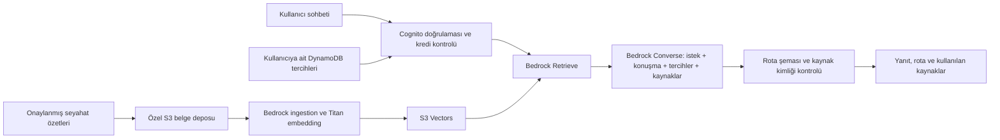

# AWS seyahat asistanı: RAG ve kullanıcı bağlamı

Bu katman mevcut Bedrock sohbet asistanına kaynaklı seyahat bilgisi ekler. Model ağırlıkları eğitilmez; belgeler Titan Text Embeddings V2 ile vektörleştirilir, yanıt anında ilgili pasajlar getirilir. Kalıcı tercihler mevcut kullanıcıya ait DynamoDB kaydında tutulur. Kullanıcı mesajları veya profil kayıtları ortak vektör deposuna yüklenmez.



## Kapsam ve sınırlar

Başlangıç korpusu `data/travel/pilot.json` içinde İstanbul, Roma ve Tokyo için üç kısa, kaynak bağlantılı gastronomi özetidir. Dünya çapında tamamlanmış bir yer/restoran kataloğu değildir. Diğer şehirlerde model yardımcı olabilir ancak ilgili kaynak kullanılmazsa genel model bilgisine dayandığını belirtir. Kaynak varlığı doğruluk garantisi değildir; pasajın son hedefle ilgisini model değerlendirir. Koordinatlar harici POI servisiyle doğrulanmaz; rota süreleri trafik/yol ağı verisiyle hesaplanmaz. Mekân puanı, fiyat, rezervasyon ve açık/kapalı durumu için canlı sağlayıcı henüz bağlı değildir.

Üretim kalitesinde küresel kapsam için ülke/şehir/mahalle bazlı lisanslı POI ve restoran verileri, resmî turizm kaynakları, işletme güncellemeleri ve ulaşım/rota sağlayıcısı gerekir. Her kaynak kendi kullanım ve önbellekleme koşullarına göre eklenmelidir. Fine-tuning ancak ölçülmüş yanıt biçimi veya davranış problemi için ayrıca değerlendirilmelidir; değişen mekân bilgisini güncel tutmanın yerini almaz.

## Veri sözleşmesi

`id`, `title`, `text`, `city`, `country`, `source_url`, `checked_at`, `valid_until`, `reviewer`, `rights`, `approved`, `visibility` zorunludur. Yalnızca `approved:true`, `visibility:public` belgeler yayımlanır. İnceleme ve son kullanım tarihi arasında en fazla 180 gün olabilir. Bu bir editoryal yeniden inceleme süresidir; canlı veri doğrulaması değildir. Kaynak adresi HTTPS olmalıdır. Veri aktarımı aracı URL'leri otomatik taramaz ve kişisel veri tespiti yapmaz; operatör yalnızca halka açık ve kullanma hakkı bulunan içerikleri sağlamalıdır.

S3 nesneleri `published/<id>.txt` ve `.txt.metadata.json` olarak yazılır. Aynı kimlikle tekrar aktarım belgeyi günceller. Bir belgeyi kaldırmak için iki nesne de silinip ingestion yeniden çalıştırılır; süre aşımı sorgu filtresiyle hemen dışlanır. Korpus dosyasından silmek S3 nesnesini otomatik silmez.

## Kurulum ve yayın

Yeni altyapı `infra/travel-rag` bağımsız Terraform state'iyle yönetilir; mevcut `infra/terraform` taslağı uygulanmaz. Kaynaklar Frankfurt'tadır. Hesap allowlist'i yanlış hesaba kurulumu önler. S3 ve vektör deposunda yanlışlıkla Terraform silmesine karşı koruma vardır. State dosyaları erişimi kısıtlı tutulmalı; eşzamanlı operatör kullanılmamalıdır.

```sh
terraform -chdir=infra/travel-rag init
terraform -chdir=infra/travel-rag validate
terraform -chdir=infra/travel-rag plan -out=travel.tfplan
terraform -chdir=infra/travel-rag show travel.tfplan
terraform -chdir=infra/travel-rag apply travel.tfplan
node infra/scripts/ingest-travel.cjs data/travel/pilot.json
node infra/scripts/ingest-travel.cjs data/travel/pilot.json --apply
```

Aktarım komutu ingestion iş kimliğini döndürür. `aws bedrock-agent get-ingestion-job` ile `COMPLETE` ve sıfır başarısız belge doğrulanmadan korpus hazır sayılmaz. Otomatik internet tarama veya zamanlanmış kaynak yenileme kurulmamıştır; içerik güncellendiğinde aktarım yeniden çalıştırılır.

Bilgi tabanı kimliğini `infra/admin-runtime/travel.auto.tfvars.json` içine `{"travel_knowledge_base_id":"..."}` biçiminde yazın. Ardından mevcut AI-only akışını kullanın:

```sh
node infra/scripts/prepare-ai-deployment.cjs
terraform -chdir=infra/admin-runtime plan -out=ai-deployment.tfplan
terraform -chdir=infra/admin-runtime show ai-deployment.tfplan
terraform -chdir=infra/admin-runtime apply ai-deployment.tfplan
```

Plan yalnızca amaçlanan AI Lambda ortamı/kodu ve Retrieve iznini değiştirmelidir. API, Cognito veya başka Lambda değişiklikleri varsa önce sebebini çözün. Geri dönüş için bilgi tabanı kimliğini boşaltıp aynı akışla AI'yı yayımlayın; bilgi deposu korunur.

## Bağlam ve güvenilirlik

En son kullanıcı isteği önceliklidir. Son altı sohbet mesajı ve izin verilen kayıtlı tercihler modele gider. Arama sorgusu son istek, son iki kullanıcı mesajı ve temizlenmiş tercihleri içerir; ayrı hesap kimliği ve profil e-postası eklenmez. Kullanıcının mesajında yazdığı içerik Bedrock'a iletilir. Geziye özgü seçimler kalıcı tercih sayılmaz. `Tercihlerimi unut` mevcut ücretsiz silme yolunu kullanır.

Retrieve en fazla altı pasaj getirir; toplam bağlam 9000 karakter, tek pasaj 1800 karakterle sınırlıdır. Arama 3 saniyede, model 23 saniyede zaman aşımına uğrar. `public`, `approved`, `valid_until` hem AWS filtresinde hem uygulamada denetlenir. Kaynak metni talimat kabul edilmez. Modelin `citedSourceIds` değerleri getirilen pasajlarla eşleştirilir; hayali kimlikler kaynak listesine alınmaz. Bu kontrol kaynak doğruluğunu veya her cümlenin kaynakça tarafından desteklendiğini kanıtlamaz.

API `sources` ve `retrievalStatus` (`available`, `empty`, `unavailable`, `disabled`) döndürür. Kullanılan kaynaklar mevcut sohbet metnine de eklenir. Arama başarısızsa model genel bilgiyle devam edebilir; kaynak kullanılmadığı açıkça belirtilir. Model yanıtı geçersizse mevcut kredi iade/idempotency işlemleri geçerlidir.

## Maliyet ve kalite

S3 belge ve vektör depolama, embedding, Retrieve ve Converse kullanımı ücretlidir. Sabit açık OpenSearch kümesi kurulmaz. Mevcut günlük 200 AI isteği limiti korunur; embedding aktarımlarını sınırlamaz. Sabit aylık maliyet veya küresel kalite garantisi verilmez. Kullanım büyümeden hesap bütçe alarmı ve erişim/veri hacmi politikaları değerlendirilmelidir.

Yayın öncesi/sonrası kontrol: ülke değiştiren takip sorusu, beslenme tercihli yemek önerisi, belirsiz hedef, kapsanmayan şehir, süresi geçmiş belge, bozuk URL, kaynak içi talimat saldırısı, kullanıcı ayrımı, tekrar istekte çift ücretlendirme, kaynak erişim hatası. Korpus büyüdüğünde uzman değerlendirmeli şehir bazlı relevance/grounding ve rota uygulanabilirliği ölçümü gereklidir.

Kaynaklar: [AWS S3 Vectors–Bedrock entegrasyonu](https://docs.aws.amazon.com/AmazonS3/latest/userguide/s3-vectors-bedrock-kb.html), [Retrieve API](https://docs.aws.amazon.com/bedrock/latest/APIReference/API_agent-runtime_Retrieve.html), [Bedrock servis rolü izinleri](https://docs.aws.amazon.com/bedrock/latest/userguide/kb-permissions.html).

Gerçek AWS RAG kontrolü (küçük model kullanım maliyeti oluşturur):

```sh
node infra/scripts/verify-travel-rag.cjs
node infra/scripts/verify-ai-api.cjs
```

İlk test gerçek vektör sorgusu ve kaynaklı Tokyo yanıtını; ikincisi doğrulanmış kullanıcı, tercih hafızası, kredi işlemleri ve tekrar isteği kontrol eder.

## 17 Eylül 2026 dağıtım kaydı

Frankfurt bölgesinde 9 RAG kaynağı oluşturuldu. Knowledge Base `IDOTP4GQGO`, veri kaynağı `6QPLSBLKKS`; ingestion `DNSVYFKQKA` üç belgeyi indeksledi, başarısız belge sayısı sıfır. Mevcut AI Lambda kodu ve ortamı güncellendi, yalnızca bu bilgi tabanına Retrieve izni eklendi. Diğer uygulama kaynakları değiştirilmedi.

Yerel doğrulama: 32 web testi, 96 backend testi ve TypeScript kontrolü başarılı. İki Terraform yapılandırması doğrulandı. Gerçek AWS model/vektör testi Tokyo yemek sorusunda GO TOKYO kaynağını ve monjayaki yanıtını doğruladı. Önceki Roma konuşması hedefi değiştirmedi. İlk canlı denemede eksik kaynak kimliği görüldü; sistem şemasına zorunlu `citedSourceIds` eklenerek düzeltilip yeniden doğrulandı. Modelin her çağrıda geçerli JSON veya doğru kaynak üreteceği garanti değildir; mevcut hata/iade yolu korunur.

Yayın sonrası `EXPECT_TRAVEL_RAG=true node infra/scripts/verify-ai-api.cjs` başarılı: Cognito girişi, canlı Lambda RAG erişimi (`available`), İstanbul ve Roma rotaları, kalıcı tercih, tekrar istekte ikinci ücret olmaması ve tercih silme doğrulandı. Geçici test hesabı ve ona ait kayıtlar temizlendi.
