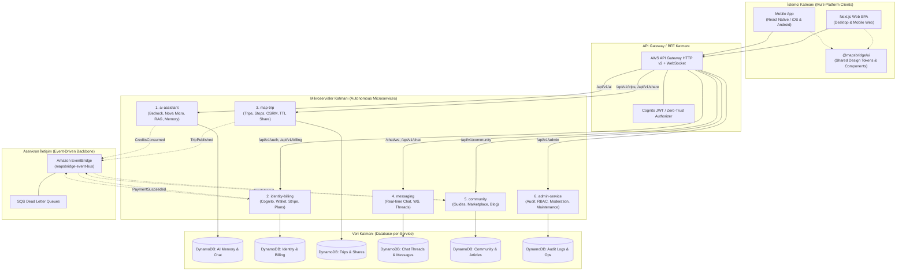

# MapsBridge — Enterprise Microservices Architecture & Modernization Blueprint

Bu belge, MapsBridge platformunun monolitik / monorepo yapısından **dağıtık, bağımsız, mikroservis tabanlı ve mobile-ready** kurumsal bir mimariye geçişinin ana teknik şartnamesidir.

---

## 1. Yönetici Özeti ve Temel Vizyon

MapsBridge; seyahat planlama, gerçek zamanlı harita ve pinleme, yapay zekâ asistanı, topluluk rehberleri ve birebir mesajlaşmayı tek bir ekosistemde sunar. Platformun büyüme hedefleri doğrultusunda sistem; hem mevcut **Web (Next.js)** hem de yakında eklenecek **Mobile (React Native / iOS & Android)** istemcilerine hizmet verecek şekilde **6 ana mikroservise** ve **1 ortak tasarım sistemine (Design System)** ayrıştırılmıştır.



---

## 2. Mikroservis Sınırları ve Sorumlulukları (Bounded Contexts)

### Servis 1: `ai-assistant` (Yapay Zekâ Seyahat Asistanı)
- **Konum:** `services/ai-assistant/`
- **Sorumluluklar:**
  - Bedrock Converse API orkestrasyonu (Amazon Nova Micro v1 & Claude Haiku 4.5).
  - Seyahat RAG motoru (Amazon Titan Text Embeddings V2 + S3 vektör arama).
  - Kullanıcı bağlamı, konuşma geçmişi (son 6–12 mesaj) ve tercih çıkarımı.
  - AgentCore Memory (Kişisel hafıza outbox akışı, 30 günlük TTL, GDPR unutulma hakkı).
  - Amazon Location Geocoding & POI arama entegrasyonu.
- **Dışa Açık API:** `POST /ai/route-planner`, `GET/PATCH/DELETE /ai/memory`, `POST /ai/clarify`.
- **Veri Sahibi:** `USER#<sub>/AI_CHAT#*`, `USER#<sub>/AI_PREFERENCES`, `USER#<sub>/AI_MEMORY#*`.

### Servis 2: `identity-billing` (Kimlik ve Kredi/Ödeme Yönetimi)
- **Konum:** `services/identity-billing/`
- **Sorumluluklar:**
  - AWS Cognito User Pool kimlik doğrulama, JWT üretimi, şifre sıfırlama, oturum iptali.
  - Kullanıcı kimliği ve profil sahipliği doğrulaması.
  - Kredi Cüzdanı Aggregate (`CreditWallet`, `WalletTransaction`, hoş geldin kredisi, atomik bakiye değişimleri).
  - Stripe Checkout Session oluşturma, Webhook imza doğrulaması (`stripe-signature`), abonelik döngüleri.
- **Dışa Açık API:** `POST /auth/login`, `POST /auth/register`, `POST /stripe/checkout`, `POST /stripe/webhook`, `GET /stripe/wallet`.
- **Veri Sahibi:** `USER#<sub>/METADATA`, `WALLET#<sub>`, `RECEIPT#<id>`, `SUB#<id>`.

### Servis 3: `map-trip` (Harita Masası ve Rota Yönetimi)
- **Konum:** `services/map-trip/`
- **Sorumluluklar:**
  - Rota ve durak veri modelleri (`Trip`, `RouteStop`, `Coordinate`).
  - OSRM / Google Maps / Leaflet koordinat hesaplama, mesafe ve süre tahminleri.
  - Süreli konum ve rota paylaşımı (`/k/:code`) ve DynamoDB TTL ile otomatik imha.
- **Dışa Açık API:** `GET/POST/PUT/DELETE /routes/*`, `GET/POST /share/*`, `GET /k/:code`.
- **Veri Sahibi:** `USER#<sub>/ROUTE#<id>`, `SHARE#<code>` (TTL özellikli).

### Servis 4: `messaging` (Gerçek Zamanlı Mesajlaşma)
- **Konum:** `services/messaging/`
- **Sorumluluklar:**
  - AWS API Gateway WebSocket bağlantı yaşam döngüsü (`$connect`, `$disconnect`).
  - Anlık mesajlaşma (`send_message`), yazıyor bildirimleri (`typing`), okundu bilgisi (`mark_read`).
  - Mesaj geçmişi HTTP API sorguları, konuşma katılımcı yetki denetimi.
  - Bağlantı izolasyonu (bağlantı süresi Cognito JWT süresini aşamaz).
- **Dışa Açık API:** `WSS /chat/ws`, `GET /chat/threads`, `GET /chat/threads/:id/messages`.
- **Veri Sahibi:** `THREAD#<id>/META`, `THREAD#<id>/MSG#<timestamp>`, `CONN#<connectionId>`.

### Servis 5: `community` (Topluluk ve İçerik Pazaryeri)
- **Konum:** `services/community/`
- **Sorumluluklar:**
  - Herkese açık seyahat rehberleri, rota listeleme ve filtreleme.
  - Seyahat blogları ve makaleleri (`/articles/`).
  - Gezgin herkese açık profil vitrini (`/@username`).
  - Rehber beğenileri, yorumları ve derecelendirme puanları.
- **Dışa Açık API:** `GET /community/guides`, `GET /marketplace/blogs`, `GET /users/:username/public`.
- **Veri Sahibi:** `PUBLIC_ROUTE#<id>`, `BLOG#<id>`, `PUBLIC_PROFILE#<username>`.

### Servis 6: `admin-service` (Yönetim ve Operasyon)
- **Konum:** `services/admin-service/`
- **Sorumluluklar:**
  - Cognito gruplarına dayalı RBAC yetkilendirmesi (`mapsbridge-admin`, `moderator`, `support`).
  - Kullanıcı askıya alma, rol değiştirme, hesap dondurma.
  - Kredi manuel ekleme/çıkarma ve denetim makbuzu (audit trail).
  - Destek talepleri (`/support/`) ve dahili not yönetimi.
  - Rota ve profil moderasyonu.
  - Sistem bakım modu (`maintenanceMode`) ve site geneli duyurular.
- **Dışa Açık API:** `GET/POST /admin/users/*`, `GET/POST /admin/audit/*`, `GET/POST /support/tickets/*`, `GET/POST /system/status`.
- **Veri Sahibi:** `ADMIN_AUDIT#<id>`, `TICKET#<id>`, `SYSTEM#STATUS`.

---

## 3. Ortak Tasarım Sistemi (Shared Design System: `@mapsbridge/ui`)

Tasarımı ve UI bileşenlerini web ve mobil arasında paylaşmak amacıyla `packages/ui` paketi konumlandırılmıştır:

```
packages/ui/
├── package.json               # @mapsbridge/ui
├── tsconfig.json
├── src/
│   ├── index.ts               # Ana kütüphane dışa aktarımı
│   ├── tokens/                # Tasarım tokenları (Renk, Font, Aralık, Gölge)
│   │   ├── colors.ts          # Emerald, Slate, Indigo, Dark mode HSL
│   │   ├── typography.ts      # Font ailesi, font boyutları, satır yükseklikleri
│   │   ├── spacing.ts         # Padding, margin ve layout grid skalaları
│   │   └── shadows.ts         # Glassmorphism, elevation ve blur değerleri
│   ├── components/            # Platform-agnostic çekirdek bileşenler
│   │   ├── button/            # Primary, Secondary, Ghost, Danger butonlar
│   │   ├── card/              # Cam efektli (Glass) kart panelleri
│   │   ├── badge/             # Durum, kredi ve etiket rozetleri
│   │   ├── avatar/            # Kullanıcı profil avatarları
│   │   └── input/             # Form alanları, text, select, switch
│   ├── icons/                 # SVG bazlı çoklu platform ikonları
│   └── styles/                # CSS Değişkenleri (--mb-*) ve reset kuralları
```

- **Web Kullanımı:** Next.js sayfaları CSS Modules veya Vanilla CSS ile `@mapsbridge/ui` token ve bileşenlerini doğrudan import eder.
- **Mobile Kullanımı:** İleride kurulacak React Native / Expo projesi bu tokenları (`colors.ts`, `spacing.ts`) ve ikonları native stillerinde sıfır maliyetle kullanır.

---

## 4. Servisler Arası İletişim (Inter-Service Communication)

### A. Senkron İletişim (Synchronous REST / HTTPS)
- İstemci (Web / Mobile) ile mikroservisler arasındaki tüm istekler **AWS API Gateway HTTP API v2** ve **WebSocket API** üzerinden yürütülür.
- Servisler birbirleriyle doğrudan HTTP üzerinden konuşmak yerine bağımsız çalışır; veri ihtiyacı JWT içerisindeki kimlik bilgisi (`sub`, `email`, `groups`) ile çözülür.

### B. Asenkron İletişim (Asynchronous EventBridge Bus)
Servisler arasındaki veri tutarlılığı ve bildirimler için **Amazon EventBridge** (`mapsbridge-event-bus`) kullanılır:

| Olay (Event) | Yayınlayan Servis | Dinleyen Servis(ler) | Amaç |
|---|---|---|---|
| `identity.user_registered` | `identity-billing` | `identity-billing` (Wallet) | Hoş geldin 5 kredisi tanımlanması |
| `billing.payment_succeeded` | `identity-billing` | `identity-billing` (Wallet) | Kredinin atomik hesaba eklenmesi |
| `ai.credits_consumed` | `ai-assistant` | `identity-billing` | Kullanıcı bakiye güncellemesi ve makbuz |
| `trip.published` | `map-trip` | `community` | Herkese açık pazaryeri kataloğuna ekleme |
| `moderation.user_suspended` | `admin-service` | `identity-billing`, `messaging` | Aktif WebSocket ve oturumların kesilmesi |

---

## 5. Veritabanı Mimarisi (Database-per-Service Stratejisi)

Kademeli geçiş (Strangler Fig) prensibiyle iki faz uygulanır:

1. **Aşama 1 (Mantıksal İzolasyon - Logical Partitioning):**
   - Mevcut yüksek performanslı DynamoDB Tek Tablo mimarisi korunur.
   - Her mikroservis yalnızca kendi Partition Key (PK) önekine erişebilir:
     - `identity-billing` ➔ `USER#`, `WALLET#`, `RECEIPT#`
     - `map-trip` ➔ `ROUTE#`, `SHARE#`
     - `messaging` ➔ `THREAD#`, `MSG#`, `CONN#`
     - `community` ➔ `COMMUNITY#`, `BLOG#`
     - `ai-assistant` ➔ `AI_CHAT#`, `AI_MEMORY#`
     - `admin-service` ➔ `ADMIN_AUDIT#`, `TICKET#`, `SYSTEM#`
   - Servislerin IAM rolü, diğer servislerin anahtarlarını okumayı/yazmayı engelleyecek `Condition` bloklarıyla sınırlandırılır.

2. **Aşama 2 (Fiziksel İzolasyon - Table-per-Service):**
   - Bağımsız ölçeklenme ve yedekleme ihtiyacı doğduğunda tablolar fiziksel olarak ayrılır:
     - `mapsbridge-identity-table`
     - `mapsbridge-trips-table`
     - `mapsbridge-chat-table`
     - `mapsbridge-ai-table`

---

## 6. Güvenlik ve Sıfır Güven (Zero-Trust Security)

1. **İstemci Kimlik Doğrulaması:**
   - AWS Cognito User Pool tarafından imzalanmış RS256 JWT Access Token kullanılır.
   - API Gateway veya Lambda Authorizer; token süresini (`exp`), imzasını (`jwks`), dinleyiciyi (`aud`) ve sağlayıcıyı (`iss`) kriptografik olarak doğrular.
2. **Servisler Arası Yetkilendirme:**
   - AWS IAM rollerine dayalı SigV4 yetkilendirmesi kullanılır. Hiçbir servisin içinde statik AWS key veya token saklanmaz.
3. **Kullanıcı Veri İzolasyonu:**
   - Sunucu, istemcinin gönderdiği kullanıcı ID veya e-posta değerine asla güvenmez; kimlik daima doğrulanmış JWT'deki `sub` değerinden alınır.

---

## 7. Dağıtık İzleme ve Gözlemlenebilirlik (Monitoring & Observability)

1. **Correlation ID & Distributed Tracing:**
   - Her gelen HTTP / WebSocket isteğine API Gateway'de benzersiz bir `x-correlation-id` atanır.
   - Bu kimlik tüm Lambda loglarına, EventBridge olaylarına ve mikroservis çağrılarına taşınır.
   - **AWS X-Ray** ile uçtan uca mikroservis gecikme haritası çıkarılır.
2. **Merkezi Loglama ve Alarmlar:**
   - CloudWatch Logs ve Logs Insights ile JSON formatında yapısal loglama (`level`, `service`, `correlationId`, `message`, `durationMs`).
   - Her mikroservis için CloudWatch Alarm metrikleri:
     - Error Rate > 1% (P1 Alarm)
     - P99 Gecikme > 1500ms (P2 Alarm)
     - Throttle Count > 0 (P1 Alarm)

---

## 8. Dizin ve Monorepo Proje Yapısı

```
location/
├── apps/
│   ├── web/                   # Next.js 16 SPA (Desktop & Mobile Web)
│   └── mobile/                # (Gelecek) React Native / Expo mobil uygulama
├── packages/
│   ├── contracts/             # Ortak Domain modelleri, DTO'lar, Event tanımları
│   ├── shared/                # Hata sınıfları, validasyonlar, core utilities
│   └── ui/                    # Ortak Tasarım Sistemi (@mapsbridge/ui)
├── services/
│   ├── ai-assistant/          # Yapay zekâ seyahat asistanı mikroservisi
│   ├── identity-billing/      # Kullanıcı kimliği, cüzdan ve ödeme mikroservisi
│   ├── map-trip/              # Harita Masası ve rota planlama mikroservisi
│   ├── messaging/             # Gerçek zamanlı sohbet ve WebSocket mikroservisi
│   ├── community/             # Gezgin topluluğu ve rehberler mikroservisi
│   └── admin-service/         # Yönetim, moderasyon ve operasyon mikroservisi
├── infra/
│   ├── terraform/             # Modüler Terraform altyapı kodları
│   │   ├── modules/
│   │   │   ├── identity-billing/
│   │   │   ├── ai-assistant/
│   │   │   ├── map-trip/
│   │   │   ├── messaging/
│   │   │   ├── community/
│   │   │   └── admin/
│   │   └── main.tf
└── docs/                      # Dokümantasyon merkezi
```

---

## 9. Uygulama ve Geçiş Stratejisi (Strangler Fig Migration)

- **Sıfır Kesinti (Zero Downtime):** Mevcut çalışan sistem ve 227 test asla bozulmaz.
- **Kademeli Paketleme:** Mikroservis klasörleri ve domain mantığı öncelikle `services/` ve `packages/` altında soyutlanır.
- **Doğrulama:** Her mikroservis modülü eklendiğinde `npm run typecheck`, `npm test` ve `npm run test:backend` çalıştırılarak tam yeşil kalması garanti edilir.
