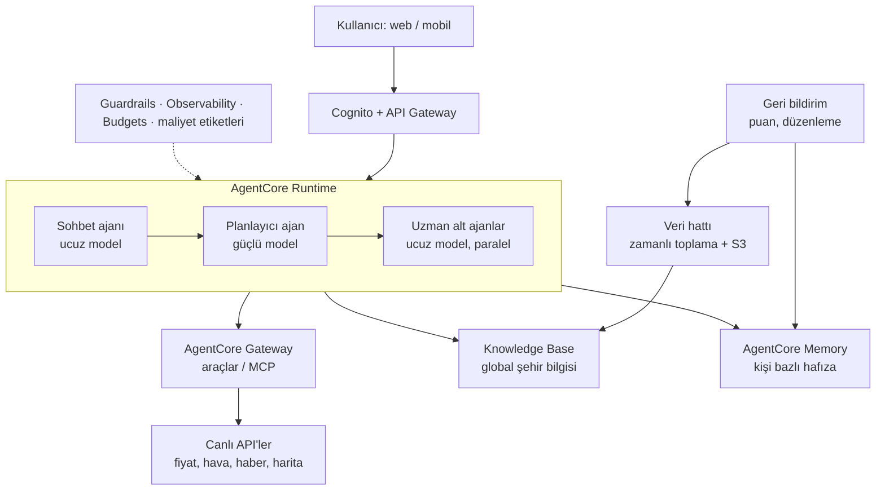

# AWS Bedrock AgentCore ile Yapay Zeka Seyahat Asistanı: Mimari ve Kurulum Rehberi

Bu doküman, kullanıcıyla sohbet ederek seyahat bilgilerini toplayan, ardından uzman alt ajanlarla yemek, spor, konaklama, ulaşım ve şehir bilgisini araştırıp uçtan uca bir seyahat rotası üreten bir sistemin AWS üzerindeki tasarımını anlatır. Seyahat sırasında acil durum desteği de verir.

> Not: AWS ürünleri hızlı değişiyor. Bölge desteği, model erişimi ve fiyatları kurulumdan önce güncel AWS dokümanından doğrula (bkz. son bölüm).

## Uygulama durumu — 2026-09-29

Mevcut ana ajan AWS Lambda üzerinde çalışıyor; AgentCore Memory ayrı `infra/ai-memory` yapısıyla entegre. Gerçek IAM doğrulamalı AgentCore Gateway mekân araştırması için hazırlandı: [kurulum ve geri dönüş rehberi](../../infra/agentcore-gateway/README.md), [doğrulama kaydı](../verification/agentcore-gateway.md). Gateway 2026-10-03 tarihinde canlıya uygulandı ve mevcut AI Lambda'ya bağlandı; [doğrulama kaydı](../verification/conversational-ai-2026-10-03.md). Aşağıdaki Runtime mimarisi hedef tasarımdır; mevcut dağıtımın kanıtı değildir.

---

## 1. Hedef ve kapsam

**Kullanıcı deneyimi**

1. Kullanıcı sohbet ederek gelir: "New York'a gideceğim."
2. Asistan doğal bir sohbetle bilgi toplar: kaç gün, ne zaman, kiminle, bütçe, neleri sever.
3. Uzman ajanlar paralel araştırır: yemek, spor, konaklama, uçuş, araç kiralama, şehir içi ulaşım, şehir bilgisi.
4. Planlayıcı ajan hepsini gün gün bir rotaya çevirir ve doğrulatır.
5. Seyahat sırasında aynı sistem güncel hava, haber ve acil durum desteği verir.

**Öğrenme (iki katman)**

- **Global:** Web/API'lerden toplanan ve kullanıcı geri bildirimiyle zenginleşen ortak bilgi tabanı.
- **Kişisel:** Her kullanıcının tercihlerini ve geçmişini hatırlayan hafıza.

**Önemli:** "Öğrenme" model eğitimi (fine-tuning) demek değildir. Model sabit kalır, öğrenme veri katmanında (Knowledge Base ve Memory) gerçekleşir.

---

## 2. Yüksek seviye mimari



---

## 3. Bileşenler ve AWS karşılıkları

| Katman | AWS servisi | Görev |
|---|---|---|
| Kimlik / giriş | Cognito, API Gateway | Kullanıcı girişi, kota, rate limit |
| Ajan çalıştırma | AgentCore Runtime | Ajanları sunucusuz, oturum izolasyonlu çalıştırır |
| Ajan framework | Strands Agents (veya LangGraph, CrewAI) | Ajan mantığı, "agents as tools" deseni |
| LLM | Bedrock (Converse API) | Claude, Nova vb. modeller |
| Araçlar | AgentCore Gateway | Lambda ve OpenAPI'leri MCP araçlarına çevirir |
| Kişisel hafıza | AgentCore Memory | Kısa ve uzun süreli kullanıcı hafızası |
| Global bilgi | Bedrock Knowledge Bases | Yönetilen RAG |
| Vector DB | S3 Vectors / Aurora pgvector / OpenSearch Serverless | Embedding depolama |
| Dış servis kimliği | AgentCore Identity | Kullanıcı adına OAuth erişimi |
| Hesaplama araçları | AgentCore Code Interpreter | Bütçe, fizibilite hesapları |
| Güvenlik / kalite | Bedrock Guardrails | PII, konu kısıtı, grounding kontrolü |
| Gözlem | AgentCore Observability, CloudWatch | Trace, log, metrik |
| Veri hattı | EventBridge, Step Functions, Lambda/Fargate, S3 | Zamanlı veri toplama ve KB güncelleme |
| Uygulama verisi | DynamoDB | Plan, profil, favoriler, kota sayaçları |
| Konum / rota | Amazon Location Service (veya Routes API) | Mesafe ve süre hesabı |
| Bildirim | EventBridge, SNS / End User Messaging | Seyahat sırası uyarılar |
| Frontend | Amplify, CloudFront | Web arayüzü |
| IaC | CDK veya Terraform | Tüm altyapı kodla yönetilir |

---

## 4. Model stratejisi (üç kademe)

| Rol | Model sınıfı | Gerekçe |
|---|---|---|
| Sohbet ajanı | Küçük/hızlı (Haiku veya Nova sınıfı) | Çok tur, düşük gecikme, düşük maliyet |
| Uzman alt ajanlar | Küçük/hızlı | Dar görev: araç çağır, özetle, yapılandırılmış çıktı ver |
| Planlayıcı ajan | Güçlü (Sonnet sınıfı) | Çelişen kısıtları birleştirme, rota kurma |
| Acil durum ajanı | Güçlü (Sonnet sınıfı) | Riskli karar, yüksek güvenilirlik |
| Embedding | Titan Embeddings veya Cohere Embed | Knowledge Base için |

Notlar:

- Converse API ile model değiştirmek kolaydır. Kademeleri ölçüm sonrası ayarla.
- Bu iş için en üst kademe modele genelde gerek yoktur.

---

## 5. Sohbet akışı tasarımı

### 5.1 Fazlar

1. **Keşif:** Sohbet ajanı bilgi toplar.
2. **Planlama:** Planlayıcı, uzman ajanları paralel çalıştırır (asenkron, ilerleme gösterilir).
3. **Sunum:** Gün gün rota, harita, bütçe özeti.
4. **İyileştirme:** Kullanıcı "şunu çıkar, şunu ekle" der, plan güncellenir.
5. **Yol modu:** Seyahat başlayınca canlı destek ve acil durum.

### 5.2 İnsan gibi sohbet için kurallar

- Tur başına en fazla bir soru sor. Form doldurma hissi yaratma.
- Hızlı yanıt butonları kullan ("kahve", "müze", "yürüyüş").
- Bilgiyi serbest metinde değil, yapılandırılmış `TripProfile` durumunda tut.
- Hafızadan doğal hatırlatma yap: "Geçen sefer üçüncü dalga kahveyi sevdiğini söylemiştin, yine öyle mi?"
- Tek seferde çok bilgi verirse hepsini yakala, tekrar sorma.
- Uzun araştırma sürecinde ilerleme mesajı göster ("Kahve ve otel araştırılıyor…").

### 5.3 TripProfile şeması (örnek)

```json
{
  "destination": "New York",
  "dates": { "start": "2026-11-10", "end": "2026-11-14", "flexible": true },
  "duration_days": 4,
  "travelers": { "adults": 2, "children": 0, "pets": false },
  "budget": { "currency": "USD", "total": 3500, "level": "mid" },
  "interests": {
    "food": ["specialty_coffee", "burgers", "local", "michelin"],
    "sports": ["running", "walking"],
    "culture": ["museums"]
  },
  "constraints": ["no_seafood", "avoid_crowds"],
  "pace": "relaxed",
  "lodging_type": ["hotel"],
  "needs": { "flights": true, "car_rental": false, "local_transit": true },
  "completeness": 0.7
}
```

`completeness` belirli eşiği geçince planlayıcı tetiklenir. Eksik alanlar için sohbet ajanı tek soru sorar.

### 5.4 Plan çıktı şeması (örnek)

```json
{
  "trip_id": "t_123",
  "days": [
    {
      "date": "2026-11-10",
      "weather_note": "Serin, yağış olasılığı düşük",
      "blocks": [
        {
          "time": "09:00-10:00",
          "type": "cafe",
          "place_id": "...",
          "name": "...",
          "why": "Kullanıcı üçüncü dalga kahveyi seviyor",
          "transit": { "mode": "subway", "minutes": 18 },
          "est_cost": 12,
          "alt": "Yağmur alternatifi: ..."
        }
      ]
    }
  ],
  "budget_summary": { "total": 3300, "by_category": {} },
  "sources": ["kb://...", "api://..."]
}
```

Arayüz bu JSON'u harita ve takvim olarak çizer. Sohbet aynı veriyi anlatır.

### 5.5 Fizibilite kontrolü (kritik)

LLM saat, mesafe ve açılış saatlerinde hata yapabilir. Plan kullanıcıya gitmeden önce deterministik bir doğrulama aracından geçmeli:

- Mekan açılış saatleri
- Bloklar arası ulaşım süreleri
- Günlük toplam yürüme / süre yükü
- Bütçe toplamı
- Hava durumuna göre alternatif

Kontrolü başarısız olan blok planlayıcıya geri gider, düzeltilir.

---

## 6. Ajanlar, araçlar ve veri kaynakları

Kural: **Hızla değişen veri KB'ye girmez, araç olarak çağrılır.** Yavaş değişen içerik KB'ye girer.

| Ajan | Canlı araç (Gateway) | KB'ye giren içerik |
|---|---|---|
| Yemek | Places / Yelp / Foursquare (açık mı, puan) | Mahalle rehberleri, kahve/burger/yerel lezzet derlemeleri, Michelin listesinin olgusal özeti |
| Spor | Parklar ve saha verisi (NYC Open Data), Places | Koşu/yürüyüş rotaları, kürek, yüzme, basket sahası rehberleri |
| Konaklama | Otel ve kiralama API'leri (fiyat, müsaitlik) | Mahalle karakteri, güvenlik, hangi mahalle kime uygun |
| Uçuş | Uçuş aggregator API'leri | Havalimanı ipuçları, aktarma bilgileri |
| Araç kiralama | Kiralama aggregator API'leri | Şehirde araç kullanımı, otopark, ücretli geçişler |
| Şehir içi ulaşım | GTFS-RT (MTA), Routes API | Metro/otobüs rehberi, bilet sistemleri |
| Şehir istihbaratı | Hava (NWS gibi), haber API/RSS | Etkinlik takvimi, kültürel notlar |
| Acil durum | Yakın hastane/eczane (Places), konum | Doğrulanmış statik protokoller |

### Veri kaynağı ve hukuki notlar

- Resmi API veya ortaklık önceliklidir. Scraping yalnızca izin veren açık kaynaklarda kullanılmalıdır.
- Airbnb için resmi genel API yoktur ve kullanım şartları scraping'e izin vermez. Bu yüzden deep-link ver veya resmi ortaklık kur.
- Michelin ve benzeri telifli rehberlerden metin kopyalama. Olgusal bilgiyi (hangi restoran yıldızlı) kendi cümlelerinle özetle.
- Üçüncü taraf API'lerin ticari kullanım koşullarını ve kotalarını başta kontrol et.

---

## 7. İki öğrenme katmanı

### 7.1 Kişisel öğrenme: AgentCore Memory

- `actorId` = kullanıcı, `sessionId` = seyahat (veya oturum).
- **Kısa süreli:** Konuşma olayları.
- **Uzun süreli:** Tercihler, olgular, seyahat özetleri.
- Örnek namespace'ler: `/users/{actorId}/preferences`, `/users/{actorId}/facts`, `/trips/{tripId}/summary`.
- **Olumsuz tercihleri de sakla:** "Balık yemez", "kalabalık sevmez". Öneri kalitesini en çok bunlar artırır.
- Belleği her turda sorgulama. Oturum başında ve planlama öncesinde çek.
- Kullanıcı hafızasını silebilsin (KVKK/GDPR).

### 7.2 Global öğrenme: Knowledge Base + geri bildirim döngüsü

1. Kullanıcı sinyalleri toplanır: plana eklenen/çıkarılan öğeler, puanlar, "beğendim/beğenmedim".
2. Anonim ve toplu şekilde S3/DynamoDB'ye yazılır (kullanıcı izniyle).
3. Haftalık batch iş bunlardan "insider tips" ve popülerlik sinyali dokümanları üretir.
4. Dokümanlar KB'ye ingestion ile eklenir.
5. Başarılı plan şablonları ("NYC, 4 gün, kahve + müze") sonraki planlarda örnek olarak kullanılır.

---

## 8. Knowledge Base ve veri hattı

### 8.1 Hat

```
EventBridge Scheduler
  → Step Functions
     → Lambda / Fargate (API çekimi, izinli crawl)
        → S3 (ham)
           → Normalizasyon (LLM ile yapılandırılmış çıkarım, batch)
              → S3 (işlenmiş)
                 → Knowledge Base ingestion job
```

### 8.2 Metadata (her kayıtta)

```
sehir, kategori, mahalle, fiyat_seviyesi, kaynak, son_dogrulama_tarihi
```

Metadata filtreleme semantik aramayla birleştirilir (örneğin `sehir=New York` ve `kategori=cafe`). `son_dogrulama_tarihi` ile bayat içerik temizlenir.

### 8.3 Genişleme stratejisi

- Önce yalnızca bir şehri (New York) çok iyi yap.
- Talep geldikçe yeni şehir ekle (talep odaklı büyüme).
- Değişmeyen sayfaları hash ile atla, yalnızca değişeni yeniden işle.
- Vector DB seçimi: MVP için S3 Vectors veya Aurora pgvector; OpenSearch Serverless'in sabit taban maliyetini hesaba kat.

---

## 9. Yol modu ve acil durum

Seyahat başlayınca aynı sistem yol moduna geçer. Plan ve hafıza zaten elinde olduğu için yanıtlar kişiye özeldir.

- Hava ve haber uyarıları EventBridge ile tetiklenir, bildirim olarak gider.
- Acil durum ajanı şu kurallara uyar:
  - Yanıtın ilk satırı deterministik olsun: hayati tehlikede yerel acil numarası (ABD için 911).
  - Cevaplar doğrulanmış protokol KB'sinden ve gerçek zamanlı konumdan gelsin.
  - Guardrails ile tıbbi/hukuki teşhis vermesi engellensin, uygun kaynağa yönlendirsin.
  - Konsolosluk, sigorta ve yakın sağlık kuruluşu bilgisini kullanıcının planından çeksin.
- Bu ajan için ayrı bir evaluation seti tut. Sistemin en sıkı test edilen parçası olsun.

---

## 10. FinOps

Maliyetin asıl kaynağı model birim fiyatından çok çarpan etkisidir: 8 ajan paralel çalışınca token tüketimi katlanır.

### 10.1 Model ve çağrı optimizasyonu

- Güçlü modeli yalnızca planlayıcıya ve acil duruma ver.
- **Router:** Kahve istemeyene yemek-kahve ajanını hiç çalıştırma. Ajanlar ilgi alanına göre çağrılsın.
- Her alt ajana `max_tokens`, maksimum araç çağrısı ve zaman aşımı koy.
- Alt ajanlar planlayıcıya uzun metin değil, kısa şemalı JSON dönsün. Planlayıcı özetleri görsün, ham konuşmayı görmesin.
- Büyük sistem promptları ve araç tanımları için **prompt caching** kullan.
- Anlık olmayan işler (KB için LLM çıkarımı, haftalık öğrenme işi) için **batch inference** kullan.

### 10.2 Cache

| Veri | Örnek TTL |
|---|---|
| Hava | ~15 dk |
| Uçuş/otel fiyatı | Dakikalar |
| Mekan bilgisi | ~1 gün |
| Taban plan (şehir + gün + ilgi kombinasyonu) | Uzun süreli, sonra kişiselleştirilir |

### 10.3 Altyapı

- KB vector DB: taban maliyeti düşük seçenekle başla, ölçek gelince gözden geçir.
- Scraping/veri toplama: Fargate Spot veya Lambda, gereksiz çalıştırma yok.
- AgentCore Memory'de uzun süreli strateji sayısını sınırlı tut, her strateji ek işlem demektir.

### 10.4 Görünürlük ve koruma

- Ajan başına **application inference profile** ve cost allocation tag kullan (hangi ajan pahalı görülsün).
- Kullanıcı başına token kotası: DynamoDB sayaç + API Gateway usage plan.
- AWS Budgets ve Cost Anomaly Detection alarmları.
- Ana metrik: **tamamlanmış plan başına maliyet**. İlk günden dashboard'a koy.
- Ajan başına gecikme ve maliyet dashboard'ı (CloudWatch + AgentCore Observability).

---

## 11. Güvenlik ve kalite

- **Guardrails:** PII maskeleme, konu dışı istek engelleme, contextual grounding check (veride olmayan bilgiyi uydurmayı azaltır).
- **Kimlik:** Kullanıcı adına dış servis erişimi için AgentCore Identity (OAuth).
- **Gizlilik:** Konum ve seyahat verisi hassastır. Rıza, saklama süresi ve silme akışı tasarla.
- **Least privilege:** Her ajan/araç için ayrı IAM rolü.
- **Evaluation:** Öneri kalitesi, doğruluk (mekan gerçekten var mı, açık mı) ve acil durum senaryoları için değerlendirme setleri.
- **Prompt injection:** Web'den gelen içeriği "veri" olarak işle, talimat olarak değil. Araç çıktısındaki metin ajanın davranışını değiştirememeli.

---

## 12. Önerilen proje yapısı

```
travel-assistant/
├── infra/                  # CDK veya Terraform
│   ├── agentcore.ts        # Runtime, Memory, Gateway
│   ├── knowledge-base.ts   # KB, vector store, data source
│   ├── pipeline.ts         # EventBridge, Step Functions, Lambda/Fargate
│   └── finops.ts           # Budgets, anomaly detection, tag'ler
├── agents/
│   ├── concierge/          # Sohbet ajanı + update_trip_profile aracı
│   ├── planner/            # Planlayıcı + fizibilite doğrulama
│   ├── food/
│   ├── sports/
│   ├── lodging/
│   ├── flights/
│   ├── car_rental/
│   ├── transit/
│   ├── city_intel/
│   └── emergency/
├── tools/                  # Gateway'e bağlanan Lambda/OpenAPI araçları
├── pipeline/               # Veri toplama ve normalizasyon kodu
├── evals/                  # Değerlendirme setleri
├── schemas/                # TripProfile ve Plan JSON şemaları
└── frontend/
```

---

## 13. Yol haritası

### Faz 0: Sohbet ve hafıza

- [ ] Bölge ve model erişimini doğrula
- [ ] Strands ile sohbet ajanı
- [ ] `update_trip_profile` aracı ve `TripProfile` şeması
- [ ] AgentCore Runtime'a deploy
- [ ] AgentCore Memory bağla (tercih stratejisi)

### Faz 1: İlk araçlar

- [ ] AgentCore Gateway kurulumu
- [ ] Otel ve yemek ajanı, canlı API'lerle
- [ ] Planlayıcı ajan ve plan JSON şeması
- [ ] Fizibilite doğrulama aracı
- [ ] Cost allocation tag ve ilk FinOps dashboard

### Faz 2: Knowledge Base

- [ ] KB ve vector store (yalnızca New York)
- [ ] Veri hattı (EventBridge + Step Functions + S3)
- [ ] Metadata şeması ve filtreleme
- [ ] Guardrails (grounding check dahil)

### Faz 3: Kalan ajanlar

- [ ] Spor, uçuş, araç kiralama, şehir içi ulaşım, şehir istihbaratı
- [ ] Router (yalnızca ilgili ajanları çağır)
- [ ] Cache katmanı

### Faz 4: Yol modu

- [ ] Konum ve bildirim akışı
- [ ] Hava/haber tetikleyicileri
- [ ] Acil durum ajanı, protokol KB'si ve özel evaluation seti

### Faz 5: Öğrenme döngüsü ve olgunlaşma

- [ ] Geri bildirim toplama ve anonimleştirme
- [ ] Haftalık batch öğrenme işi
- [ ] Otomatik evaluation ve regresyon testleri
- [ ] Kullanıcı başına kota ve tam FinOps izleme

---

## 14. Kurulumdan önce doğrulanacaklar

- AgentCore'un bölge desteği ve güncel fiyat modeli.
- Seçilen modellerin hedef bölgede kullanılabilirliği.
- S3 Vectors ve seçilen vector DB'nin bölge desteği ve fiyatı.
- Üçüncü taraf API'lerin ticari kullanım koşulları, kotaları ve maliyetleri.
- Veri konumu ve gizlilik gereksinimleri (kullanıcıların bulunduğu bölge, KVKK/GDPR).
- Seyahat sırasında konum ve bildirim izinleri için mobil platform gereksinimleri.

---

## 15. Sözlük

| Terim | Anlamı |
|---|---|
| Agent / sub-agent | Belirli görevi olan LLM tabanlı çalışan; sub-agent, üst ajanın çağırdığı uzman |
| Supervisor / planner | Alt ajanları yöneten ve sonuçları birleştiren ajan |
| RAG | Modelin cevap üretmeden önce bilgi tabanından ilgili içeriği getirmesi |
| Knowledge Base | Bedrock'un yönetilen RAG servisi |
| AgentCore Memory | Ajanlar için kısa/uzun süreli hafıza servisi |
| AgentCore Gateway | Araçları MCP üzerinden ajanlara sunan katman |
| Guardrails | İçerik, PII ve doğruluk kontrolleri |
| MCP | Model Context Protocol; ajanların araçlara erişim standardı |
| Grounding check | Cevabın kaynak veriye dayanıp dayanmadığını denetleme |
