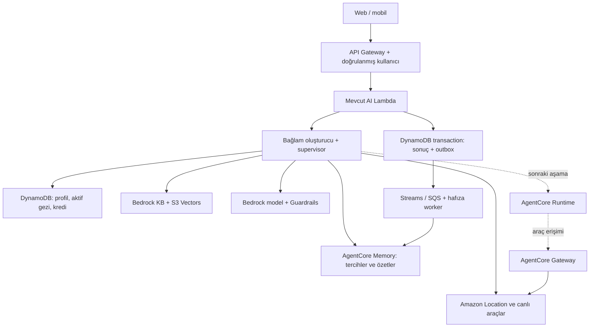

# Seyahat asistanı: AgentCore Memory ve alan uyarlama planı

Tarih: 26 Eylül 2026. Tasarımın başlangıç kaydıdır. **27 Eylül 2026 uygulama durumu:** [uygulama ve işletim kaydı](../ai/memory.md). Aşağıdaki mevcut-durum bulguları uygulama öncesine aittir.

Öneri: mevcut Bedrock + Lambda + DynamoDB akışına önce güvenilir kimlik ve kullanıcıya özel AgentCore Memory eklemek; seyahat bilgisini mevcut RAG katmanında geliştirmek; küçük bir temel modeli fine-tuning ile özelleştirmeyi ölçülebilir bir pilot olarak yürütmek. AgentCore Runtime ve Gateway geçişi sonraki aşamada yapılmalı.

İnceleme yerel kaynak kodu, Terraform tanımları, mevcut planlar ve güncel AWS belgelerini kapsar. AWS hesabındaki canlı kaynaklar, yayımlanan Lambda paketi, kota, model erişimi ve fatura bu çalışma sırasında sorgulanmadı. Kodda bulunması, bir özelliğin canlıda etkin olduğunu kanıtlamaz. Bu paragraf ilk planlama incelemesini anlatır; sonraki uygulama ve canlı doğrulamalar bağlantılı uygulama kaydındadır.

## 1. Mevcut yapıda gerçekten bulunanlar

| Alan | Kaynakta gözlenen durum | Plan açısından sonuç |
|---|---|---|
| İstek akışı | `POST /ai/route-planner` → AI Lambda → `apps/web/server/ai-handler.ts` → `runMultiAgentSupervisor` | Mevcut API ve kredi sözleşmesi korunabilir. |
| Model | `infra/admin-runtime/main.tf` içinde `eu.anthropic.claude-haiku-4-5-20251001-v1:0`; `bedrock-client.ts` içinde Converse çağrısı | Önce bu model referans kalite seviyesi olarak ölçülmeli. |
| Orkestrasyon | `supervisor.ts`: niyet/bağlam çıkarımı, netleştirme, RAG + yer araştırması, yanıt/rota üretimi; belirli isteklerde ek uzman fonksiyonları | Fonksiyon isimleri AgentCore üzerinde çalışan bağımsız ajanlar anlamına gelmiyor. |
| Kalıcı tercihler | `USER#<sub> / AI_PREFERENCES`; tempo, bütçe, seyahat stili, ilgi alanları için sınırlı değer listesi | İyi bir başlangıç; kaynak, güven, kapsam, güncellik ve kullanıcı onayı bilgisi eksik. |
| Sohbet durumu | `USER#<sub> / AI_CHAT#<conversationId>`; profil, rota, bağlam, sürüm ve mesajlar | Güncel seyahatin kesin durumu DynamoDB'de kalmalı. |
| Geçmiş | API istemciden en fazla 6 mesaj kabul ediyor; `model-history.ts` sunucu geçmişini 12 mesajla sınırlıyor | Eski belgelerdeki “son altı mesaj” açıklaması mevcut akışın tamamını anlatmıyor; semantik uzun dönem hafıza yok. |
| Tercih çıkarımı | `supervisor.ts` kalıcı güncellemeyi “genelde”, “her seyahat”, “tercihim” benzeri ifadelerle sınırlandırıyor | Geçici istek ile kalıcı tercih ayrımı korunmalı ve örneklerle geliştirilmeli. |
| Silme | `forgetAIPreferences` yalnızca tercih kaydını boşaltıyor | Sohbet, makbuzdaki yanıt ve ileride AgentCore kayıtları için ayrı silme sözleşmesi gerekli. |
| İşlem bütünlüğü | `billing/store.ts` yanıt, kredi, tercih ve sohbet güncellemesini DynamoDB transaction ile tamamlıyor; sohbet sürüm kontrolü var | Memory yazımı bu transaction'a doğrudan dahil edilemez; outbox gerekli. |
| Bilgi tabanı | `retrieval.ts`: Bedrock Retrieve; public/approved/valid_until kontrolleri; şehir kontrolü; 6 pasaj sınırı | RAG altyapısı yeniden kurulmadan genişletilebilir. Mevcut sorgu mantığı gastronomi ağırlıklı. |
| Vektör altyapısı | `infra/travel-rag/main.tf`: S3 + S3 Vectors + Titan embedding + Bedrock KB | Eski `infra/terraform/ai.tf` içindeki OpenSearch taslağıyla karıştırılmamalı. |
| Yer araştırması | `place-research.ts`: Amazon Location Geocode ve SearchText; gerçek yer kimliği ve koordinatları | Canlı fiyat, müsaitlik ve açılış saati doğrulamasını ayrıca eklemek gerekir. |
| Gateway | `gateway-tools.ts` araç şemaları ve yerel hesaplayıcılar içeriyor | İncelenen akışta AgentCore Gateway servis çağrısı yok. Haversine hesabı gerçek ulaşım süresi değildir. |
| Guardrails | `guardrails.ts` yerel regex/heuristic kontroller içeriyor; Converse çağrısında `guardrailConfig` yok | Yönetilen Bedrock Guardrails'in etkin olduğu varsayılamaz. |
| AgentCore / eğitim | İncelenen uygulama ve altyapı kaynaklarında Memory SDK işlemleri, Runtime çağrısı veya fine-tuning iş hattı bulunmadı | Bunlar ek geliştirme kapsamı. |
| Değerlendirme | `apps/web/evals/travel-dialogues.json`, `evals/`, testler ve `infra/scripts/evaluate-ai-dialogues.cjs` var | Yeni hafıza ve eğitim değerlendirmelerinin temeli olarak kullanılmalı. |

Kaynaklar: [AI handler](../../apps/web/server/ai-handler.ts), [supervisor](../../apps/web/app/lib/ai/supervisor.ts), [model çağrısı](../../apps/web/app/lib/ai/bedrock-client.ts), [tercihler](../../apps/web/app/lib/ai/preferences.ts), [geçmiş](../../apps/web/app/lib/ai/model-history.ts), [işlem deposu](../../infra/lambda/src/billing/store.ts), [RAG](../../apps/web/app/lib/ai/retrieval.ts), [aktif dağıtım tanımı](../../infra/admin-runtime/main.tf), [RAG altyapısı](../../infra/travel-rag/main.tf).

Eski [AgentCore mimarisi](agentcore-architecture.md) hedef tasarım olarak yararlı. Ancak [işletim rehberi](../reports/ai-architecture-operations.md) içindeki AgentCore/OpenSearch anlatımı ile [docs/ai/runtime.md](../ai/runtime.md) içindeki Nova Micro bilgisi güncel kaynakla birlikte değerlendirilmelidir. İlk iş mevcut/hedef/canlı doğrulanmış durumlarını bu belgelerde ayırmaktır.

## 2. Öncelikli bulgu: kullanıcı kimliğine güven sınırı

`ai-handler.ts` içindeki `resolveUser`, `getVerifiedUser` başarısız olduğunda düz e-posta, imzası doğrulanmadan çözümlenen JWT claim'leri ve belirli uzunluktaki rastgele tokenlardan kimlik üretiyor. JWT dalı `sub` değerini doğrudan kullanabiliyor. Bu nedenle kişisel verinin anahtarı güvenilir kimliğe bağlanmış sayılmaz. Aynı handler cüzdan okuma ve tercih silme işlemlerini de yapıyor.

`infra/admin-runtime/main.tf` route tanımında ayrıca bir JWT authorizer görünmüyor. Canlı erişim katmanında başka önlem bulunup bulunmadığı doğrulanmadı; kaynak bulgusu tek başına dağıtım öncesi engeldir.

İlk teslimat:

1. AI handler yalnız ortak doğrulanmış kimlik sonucunu kabul etsin; doğrulama başarısızsa 401 dönsün.
2. Google girişi gerekiyorsa Cognito federasyonu veya issuer/audience/expiry doğrulaması olan sunucu kimlik eşlemesi kullanılsın. Aynı kişinin sağlayıcılar arasındaki hesap eşlemesi açık olsun.
3. Kullanıcı, actor, session, trip ve memory namespace değerleri sunucuda türetilsin. İstemci yalnız kendi seyahatini/sohbetini seçebilsin.
4. İmzasız/sahte JWT, düz e-posta ve rastgele token testleri handler seviyesinde çalışsın; reddedilen istek kredi, tercih veya hafıza verisine erişemesin.
5. Profil bağlamı sahipliği sunucudan doğrulansın. `conversationHistory`, manifesto, RAG ve araç çıktıları kullanıcı kimliği veya sistem talimatı olarak değerlendirilmesin.

Ek tutarlılık işi: mevcut istek fingerprint'i prompt, history ve conversationId içeriyor; yanıtı etkileyebilen manifesto, konum ve profil bağlamını içermiyor. Normalize edilmiş bütün etkili girdiler fingerprint'e dahil edilmeli. Aynı requestId ile farklı etkili girdiler 409 dönmeli.

## 3. AWS servislerinin önerilen görev dağılımı

| İhtiyaç | Seçim | Ne zaman? |
|---|---|---|
| Dil modeli ve yapılandırılmış çıktı | Bedrock Converse + modele göre adaptör | Mevcut, geliştirilecek |
| Kullanıcıya özel uzun dönem bağlam | AgentCore Memory | İlk ana geliştirme |
| Güncel profil, seyahat, kredi, işlem sürümü | DynamoDB | Korunacak |
| Ortak seyahat bilgisi | Bedrock Knowledge Bases + mevcut S3 Vectors | Mevcut, kapsamı büyütülecek |
| Model giriş/çıkış politikaları | Bedrock Guardrails | İlk aşamalar |
| Uzun araştırma / ajan yürütme | AgentCore Runtime | İhtiyaç ve ölçüm sonrasında |
| Araç erişimini birleştirme | AgentCore Gateway | Araç sözleşmeleri oturduktan sonra |
| Kullanıcı adına dış servis OAuth | AgentCore Identity | Böyle bir entegrasyon gerektiğinde |
| Seyahat davranışına model uyarlama | Bedrock model customization; gerekirse SageMaker AI + uygun dağıtım | Ölçümlü pilot |
| Telemetri | CloudWatch; Runtime geçişinde AgentCore Observability | İlk günden |

Memory'yi kullanmak için Runtime geçişini beklemek gerekmiyor; AgentCore bileşenleri bağımsız kullanılabilir. Frankfurt, incelenen AWS tablosunda Memory, Runtime ve Gateway için destekleniyor. Bölgesel destek, hesaptaki erişim/kota garantisi değildir. [AgentCore ürün/fiyat yapısı](https://aws.amazon.com/bedrock/agentcore/pricing/), [bölge tablosu](https://docs.aws.amazon.com/bedrock-agentcore/latest/devguide/agentcore-regions.html).



## 4. Kullanıcıya özel context ve memory tasarımı

### Dört ayrı veri katmanı

| Katman | Örnek | Asıl kayıt yeri |
|---|---|---|
| Açık kullanıcı profili | “Genelde sakin gezerim”, tercih edilen dil | DynamoDB; Memory için doğrulanmış kaynak |
| Aktif seyahat durumu | Roma, üç gün, bu seyahat için esnek bütçe, seçili duraklar | DynamoDB TripProfile / AI_CHAT |
| Uzun dönem deneyim | Geçmiş seyahat özeti, tekrarlanan ilgi, kaçınılan etkinlik | AgentCore Memory |
| Ortak bilgi ve canlı gerçekler | Mahalle rehberi, rota süresi, müsaitlik | KB veya canlı API |

“Bu seyahatte pahalı bir otelde kalacağım” kalıcı lüks tercihi oluşturmaz. “Genelde ekonomik otel tercih ederim” profil adayıdır. “Artık vejetaryen değilim” önceki tercihi geçersiz kılar. Aynı turda açıkça verilen düzeltme, eski hafıza çıkarımını beklemeden uygulanır.

### Kimlik ve kapsam

- Her ortam için ayrı Memory kaynağı; kullanıcı başına AWS kaynağı oluşturulmaz.
- `actorId`: sunucunun doğruladığı hesabın opak kimlik eşlemesi. E-posta veya istemcinin gönderdiği userId kullanılmaz.
- `sessionId`: sunucunun sahipliğini doğruladığı conversationId; `tripId` ayrı tutulur. Bir seyahatin birden fazla sohbeti olabilir.
- Tercihler: `/users/{actorId}/preferences/`.
- Oturum özetleri: `/users/{actorId}/sessions/{sessionId}/summaries/`.
- Sonradan açılabilecek doğrulanmış olgular: `/users/{actorId}/facts/`.

Namespace tek başına yetkilendirme sağlamaz. Uygulama sahiplik kontrolü, yalnız sunucunun Memory'ye erişmesi ve servis tarafından desteklenen actor/session/namespace IAM koşulları birlikte kullanılmalı. Ortak Lambda rolünün tüm kullanıcıları okuyabildiği durumda, yalnız isimlendirme ile izolasyon sağlandığı iddia edilmemeli. [AWS memory organizasyonu ve IAM kapsamları](https://docs.aws.amazon.com/bedrock-agentcore/latest/devguide/memory-organization.html).

### İlk Memory stratejileri

Başlangıçta tercih çıkarımı ve oturum özetleme kullanılsın. Serbest semantic facts ve episodic stratejiler kalite/maliyet verisi geldikten sonra değerlendirilsin. Gerekirse tercih çıkarımı seyahat alanına özgü kurallarla özelleştirilsin: geçici istekleri kalıcılaştırmama, kullanıcı ifadesine dayanma, olumsuz tercihleri koruma. AgentCore uzun dönem çıkarımı asenkrondur; aynı istekte yeni kaydın okunacağı varsayılmamalı. [Memory stratejileri](https://docs.aws.amazon.com/bedrock-agentcore/latest/devguide/memory-strategies.html), [özelleştirme](https://docs.aws.amazon.com/bedrock-agentcore/latest/devguide/memory-custom-strategy.html), [hafıza tipleri](https://docs.aws.amazon.com/bedrock-agentcore/latest/devguide/memory-types.html).

Uygulamanın normalize ettiği hafıza kaydı aşağıdaki alanları taşımalı. Bu, AWS API'sinin doğrudan şeması değildir; gerekirse ek provenance bilgisi DynamoDB'de tutulur.

```json
{
  "kind": "preference",
  "key": "pace",
  "value": "relaxed",
  "scope": "user",
  "source": "explicit_user_statement",
  "sourceConversationId": "conversation_...",
  "sourceEventId": "event_...",
  "confirmation": "confirmed",
  "updatedAt": "2026-09-26T10:00:00Z",
  "expiresAt": null,
  "schemaVersion": 1,
  "memoryGeneration": 1
}
```

Model çıkarımı kullanıcı onayı sayılmaz. Çıkarılmış kayıtlar açık profil değerlerini otomatik değiştirmemeli. Sistem güven puanı üretiyorsa bu puan kalibre edilmeden olasılık veya doğruluk garantisi olarak gösterilmemeli.

### Her istekte bağlam oluşturma

1. Kimliği, sohbet sahipliğini, hafıza iznini ve memoryGeneration değerini doğrula.
2. DynamoDB'den güncel profil, aktif seyahat ve son mesajları getir.
3. İlgili kişisel hafızayı sınırlı sayıda getir; başlangıç hedefi en fazla 5 kayıt ve 1.500 token. Önbellek anahtarı kullanıcı + hafıza sürümü + sorgu kapsamını içersin.
4. Çakışmada öncelik: mevcut açık kullanıcı talebi → bu seyahatin açık kısıtları → kullanıcı onaylı profil → geçmişten çıkarılmış tercihler. Ürün güvenlik kuralları bu veri önceliğinin dışındadır.
5. Seyahat RAG'ını şehir/kategori/güncellik filtresiyle getir; gerektiğinde canlı araç çağır.
6. Model için her kaynağı açıkça etiketle; hafıza, kaynak metni ve araç çıktıları sistem talimatına dönüşmesin.
7. Üretimi şema, araştırılmış yer kimlikleri, rota fizibilitesi ve kaynak ilişkisi bakımından doğrula.
8. Yanıt/kredi/seyahat güncellemesiyle birlikte hafıza outbox kaydını tamamla.

Başlangıçta toplam dinamik bağlam için yaklaşık 8.000 token üst sınırı önerilir; sistem promptu ve araç şemaları ayrıca ölçülür. Kesme sırası önce ilgisiz/eski kaynaklar olmalı; açık kullanıcı kısıtları korunmalı. Karakter sınırlarının yanında gerçek token tüketimi izlenmeli. Bu rakamlar ürün hedefidir, AWS kotası değildir.

### Yazım, hata ve tekrar davranışı

`finishAI` transaction'ına kullanıcı + requestId ile tekilleşen `MEMORY_OUTBOX` kaydı eklensin. Streams/SQS worker, yalnız tamamlanmış işlemleri ve izin verilen içeriği `CreateEvent` ile Memory'ye aktarsın. Outbox durumu, deneme sayısı ve servis eventId'si takip edilsin; başarısız işler DLQ'ya düşsün.

En az bir kez teslimatta SDK/servis idempotency desteği doğrulanmalı; destek yoksa belirsiz timeout sonrasında event çoğalmasını tespit eden uzlaştırma yapılmalı. AWS çağrısı ile DynamoDB onayını tek atomik işlem gibi tasarlamamak gerekir. Kullanıcıya aynı istekte iki ücret yansımamalı ve Memory arızası tamamlanmış yanıtı geri almamalı.

Memory okuması zaman aşımında güncel profil ve seyahat durumu ile devam edilsin; eksik hafıza uydurulmasın. Hassas/kesin kısıtlar yalnız asenkron Memory'ye bırakılmasın. Başlangıç Memory okuma bütçesi 800 ms olarak ölçülecek; gerçek gecikmeye göre ayarlanacak.

### Kullanıcı kontrolü ve silme

Arayüzde “Hatırladıklarım” alanı: kayıtları görme, düzeltme, tek kayıt silme, kalıcı hafızayı kapatma ve tüm AI geçmişini silme. Hafıza izni ile model eğitimi için veri kullanım izni ayrı tutulmalı.

Önerilen API'ler: `GET /ai/memory`, `PATCH /ai/memory/{id}`, `DELETE /ai/memory/{id}`, `DELETE /ai/memory`, `GET /ai/memory/deletion-status`. Mevcut `forgetPreferences` davranışı açıklanarak korunmalı; tüm geçmişi silme ile aynı işlem sayılmamalı.

Silme iş akışı önce kapsamı tombstone ile erişime kapatsın ve hafıza sürümünü artırıp önbelleği geçersiz kılsın. Sonra kısa dönem event'leri, türemiş uzun dönem kayıtları, ilgili sohbet/profil alanları ve izin kapsamındaki kopyalar silinsin. Eski outbox işleri sürüm denetimiyle yazamasın. Tüm hafıza sıfırlamasında yeni actor eşlemesi/eski actor'un okunmaması, gecikmiş çıkarımın tekrar görünmesini önleyen seçenek olarak değerlendirilsin; eski kayıtların gerçek silinmesi ayrıca tamamlanmalı.

Event silmek türemiş uzun dönem kayıtların silindiği anlamına gelmez. Uzun dönem kayıtlar ayrıca silinmeli; yarışan çıkarımlar için tekrar tarama ve doğrulama gerekli. [AWS event ve kayıt yaşam döngüsü](https://docs.aws.amazon.com/pdfs/bedrock-agentcore/latest/devguide/bedrock-agentcore-dg.pdf), [DeleteMemoryRecord](https://docs.aws.amazon.com/bedrock-agentcore/latest/devguide/long-term-delete-memory-records.html).

Önerilen başlangıç saklama politikası: ham sohbet event'leri 30 gün, seyahat özetleri 180 gün, onaylı tercihler kullanıcı değiştirdiğinde/sildiğinde güncelleme. Bunlar ürün kararlarıdır. AWS event expiry ayarı tüm kopyalara ve uzun dönem kayıtlara uygulanmış sayılmaz. DynamoDB, log, yedek ve işlem makbuzlarının saklama politikası ayrıca tanımlanmalı; finansal kayıt tutulacaksa içindeki AI yanıtı ve tercih kopyası ayrıştırılmalı. Hassas sağlık/erişilebilirlik bilgisi yalnız açık ihtiyaç ve kullanıcı kontrolüyle işlenmeli; tam konum geçmişi varsayılan kalıcı hafızaya alınmamalı.

## 5. Seyahat alanına fine-tuning planı

Eğitimin hedefi: Türkçe ve hedeflenen diğer dillerde niyeti anlama, eksik bilgiyi tek soruyla isteme, geçici/kalıcı tercihi ayırma, TripProfile ve rota düzenleme şemasına uyma, uygun aracı seçme ve veri bulunmadığında bunu açık söyleme.

Kullanıcının özel geçmişi model ağırlıklarına yazılmamalı. Otel fiyatı, açılış saati ve güncel etkinlik gibi değişen bilgi için RAG/canlı araç kullanılmalı. Fine-tuning bu katmanların yerini almaz; eğitimden sonra da aynı memory ve kaynak akışı kullanılacak.

### Model seçimi

| Aday | Rol | Karar koşulu |
|---|---|---|
| Mevcut Claude Haiku 4.5 | Referans model ve başlangıç üretim modeli | Mevcut davranış ve maliyet ölçülür. |
| Nova Micro | Küçük metin modeliyle niyet/profil çıkarımı pilotu | Türkçe, tool schema, güncelleme doğruluğu ve toplam maliyet yeterliyse |
| Nova Lite / Nova 2 Lite | Daha geniş danışmanlık ve araç kullanım pilotu | Daha küçük adayın kalite açığını kapatıyorsa |
| Desteklenen açık ağırlıklı model + SageMaker AI | Daha fazla eğitim kontrolü gereken alternatif | Yönetilen Bedrock pilotu ihtiyacı karşılamazsa; ek operasyon maliyetiyle |

İncelenen Bedrock fine-tuning tablosunda Nova Micro/Lite ve Nova 2 Lite için `us-east-1` listeleniyor. Mevcut Haiku 4.5 tablodaki Claude 3 Haiku ile aynı model değil; fine-tuning desteği var kabul edilmeyecek. Eğitim ve özelleştirilmiş modelin inference bölgesi, API/tool desteği ve dağıtım türü ayrı ayrı doğrulanmalı. Frankfurt Memory desteği, Frankfurt'ta seçilen modeli eğitme desteği anlamına gelmez. [Bedrock desteklenen eğitim modelleri](https://docs.aws.amazon.com/bedrock/latest/userguide/custom-model-fine-tuning.html).

AB içinde işlem gereksinimi varsa, ABD bölgesinde eğitim destekli bir aday otomatik seçilmez. Önce bölgesel gereksinimi karşılayan aday değerlendirilir; ABD pilotunda yalnız kişisel veri içermeyen editoryal/sentetik örnekler kullanılması teknik seçenek olarak ele alınır. Açık model alternatifi için Bedrock import mimari/format desteği ayrıca kontrol edilir. [Custom Model Import](https://docs.aws.amazon.com/bedrock/latest/userguide/model-customization-import-model.html).

### Veri ve deney akışı

1. Mevcut değerlendirme senaryolarını genişlet; ilk pilot için 300–500 uzman gözden geçirmeli, çok turlu ve şehir çeşitliliği olan test senaryosu hedefle.
2. Eğitim için 2.000–5.000 kaliteli örnek başlangıç hedefi koy. Bu sayı AWS alt sınırı veya başarı garantisi değil; öğrenme eğrisine göre güncellenecek.
3. Örnek türleri: tarih/bütçe netleştirme, aynı şehirde rota düzenleme, şehir değiştirme, kalıcı tercih düzeltme, geçici tercih, beslenme kısıtı, kaynak yokluğu, araç hatası, kaynaktaki kötü amaçlı talimatı yok sayma.
4. Şema: system + çok turlu user/assistant + gerekiyorsa araç sonuçları; seçilen modelin gerçek eğitim formatına dönüştür. Temsili JSON'u her modele aynen yükleme.
5. Örnekleri kullanıcı/sohbet/rota şablonu bazında gruplayıp yaklaşık %80 eğitim, %10 doğrulama, %10 test ayır; yakın kopyaları bölümler arasında paylaşma. Bazı şehirleri ve sonraki tarihleri yalnız testte tut.
6. Hakları uygun, kişisel veriden arındırılmış editoryal örneklerle başla. Gerçek konuşmalar ayrı eğitim izni olmadan eklenmez. Model üretimi örnekleri insan denetiminden geçer.
7. S3 üzerinde sürümlü veri, etiketleme kılavuzu, ayrı IAM rolü ve KMS yapılandırmasıyla Bedrock customization job oluştur. Dataset sürümü, base model, parametreler ve eğitim maliyeti kayıt altına alınır. [Veri hazırlama](https://docs.aws.amazon.com/bedrock/latest/userguide/model-customization-prepare.html), [eğitim işi](https://docs.aws.amazon.com/bedrock/latest/userguide/model-customization-submit.html).
8. Aynı RAG, araçlar, hafıza ve bağlam bütçesiyle üçlü karşılaştırma yap: mevcut Haiku, eğitilmemiş küçük aday, fine-tuned küçük aday. Böylece iyileşmenin eğitimden mi bağlamdan mı geldiği ölçülür.
9. İlk üretim denemesinde yalnız niyet/profil çıkarımını küçük modele yönlendir; rota üretimi referans modelde kalabilir. Geçersiz çıktı için tek kontrollü fallback ve toplam maliyet sınırı uygula.
10. Test kapıları geçilirse %5 → %25 → %100 trafik. Model/prompt/şema sürümleriyle anında geri dönüş mümkün olsun. Eğitim periyodik veya yeni bir hata kümesi biriktiğinde yapılır; her konuşmadan otomatik eğitim başlatılmaz.

Kabul hedefi: şema geçerliliği ≥%99, açık kullanıcı kısıtlarına uyum ≥%95, tercih kapsamı/düzeltme doğruluğu ≥%95; testte kullanıcılar arası veri erişimi sıfır. Fine-tuned adayın mevcut modele karşı görev başarısı en fazla 2 yüzde puan düşerken başarılı görev başına toplam maliyeti en az %20 azaltması veya belirgin kalite kazanımı sunması hedeflenir. Bunlar pilot karar eşikleri; ölçülmüş sonuçlar değildir. Türkçe ve diğer diller ayrı raporlanır, örnek sayısı ve güven aralığı verilir. Eğitim, barındırma ve fallback maliyeti dahil edilmeden kazanç ilan edilmez.

## 6. RAG, araçlar ve Runtime geçişi

RAG tarafında mevcut küçük pilot korpus şehir/kategori bazında büyütülmeli. Şehir filtresi mümkün olduğunca vektör sorgusuna taşınmalı; sonradan 6 sonuç içinden şehir elemek ilgili belgenin bulunmasını engelleyebilir. Özel kullanıcı hafızası ortak KB'ye karıştırılmamalı. Kaynak tarihi, kullanım hakkı, dil, şehir ve geçerlilik süresi metadata'da tutulmalı.

İlk araç seti: mevcut yer arama, gerçek rota süresi/mesafesi, hava durumu; ardından sağlayıcı erişimi varsa konaklama/uçuş müsaitliği. Araç sonucu `status`, `source`, `checkedAt`, `expiresAt` ve tipli veriyi içersin. Tahmini ziyaret süreleri tahmin olarak işaretlensin. Eksik araç sonucu modele kesin bilgi ürettirmesin.

Bedrock Guardrails Converse entegrasyonu model çağrısına bağlanmalı; yerel regex dosyası yönetilen kontrolün yerine geçmez. Guardrails kaynak doğruluğu veya rota fizibilitesi garantisi değildir. [Converse ile Guardrails](https://docs.aws.amazon.com/bedrock/latest/userguide/guardrails-use-converse-api.html).

Runtime geçişinde mevcut TypeScript supervisor bir adaptörle taşınabilir; Python/Strands zorunlu yeniden yazım yapılmamalı. Önce tek supervisor ve ihtiyaca göre çağrılan araçlar yeterli. Çok sayıda uzman ajan ancak ölçülen kalite kazanımı ek çağrı maliyetini karşılıyorsa açılmalı.

Mevcut Lambda timeout'u 30 saniye. AgentCore'a geçmek dış API zaman sınırını kendiliğinden kaldırmaz. Uzun araştırma için `202 + jobId`, kullanıcıya bağlı iş durumu sorgusu ve gerekirse mevcut WebSocket kanalıyla ilerleme olayları tasarlanmalı. Başlangıçta senkron kısa istek sözleşmesi korunabilir. İşin sonlandırılması, retry ve kredi tamamlanması ayrı durum makinesiyle idempotent yürütülmeli.

Gateway'de önce salt okunur araçlar yayımlansın. Araç argümanlarında kullanıcı kimliği model tarafından seçilmesin; sahiplik backend'de uygulansın. Rezervasyon/ödeme gibi yazan araçlar ileride eklenirse teklif ve onay ayrı adımlar olsun. Identity yalnız gerçekten kullanıcı adına dış servis yetkisi gerektiğinde eklensin.

## 7. Uygulama sırası ve somut teslimatlar

Süreler bir backend/AWS geliştiricisi, kısmi frontend ve değerlendirme desteği varsayan yaklaşık iş günü tahminidir. Hesap erişimi, sağlayıcı anlaşmaları ve veri etiketleme beklemeleri dahil değildir.

| Aşama | İş | Teslimat / çıkış koşulu | Tahmin |
|---|---|---|---|
| F0 | Kimlik fallback'lerini kaldır; fingerprint ve doküman farklarını düzelt; canlı envanteri salt okunur doğrula | Sahte kimlik reddi, sahiplik testleri, model/KB/dağıtım sahipliği listesi | 2–3 gün |
| F1 | Profil/seyahat/hafıza sözleşmeleri; izin, provenance ve bağlam bütçesi | Tek context builder, güncel talep önceliği, eski profil migrasyonu | 3–5 gün |
| F2 | Frankfurt Memory, iki strateji, IAM, outbox/worker, silme ve ayarlar ekranı | Oturumlar arası hatırlama, izolasyon, unutma ve hata senaryoları çalışır | 5–8 gün |
| F3 | RAG kapsamı, canlı araç sözleşmeleri, Guardrails, metrikler | Kaynak ve yer doğrulaması; timeout'ta dürüst eksik sonuç; maliyet baseline | 4–7 gün |
| F4 | Gerekliyse Runtime + Gateway pilotu | İşlem/ücret sözleşmesi korunur; uzun iş takibi ve geri dönüş denenir | 5–8 gün |
| F5 | Küçük model eğitimi ve karşılaştırma | Sürümlü veri, değerlendirme raporu ve üretime geç/geçme kararı | 8–15 gün + etiketleme |

F0 → F1 → F2 öncelikli zincirdir. F3, F1 sonrasında başlayabilir. F5 için baseline ve veri hazır olmalı; F4 zorunlu önkoşul değildir. İlk kişisel hafıza sürümü yaklaşık 2–4 hafta, tam pilot kapsamı kaynak ve beklemelere göre yaklaşık 6–10 hafta olabilir.

Önerilen dosya değişiklikleri:

| Konum | İş |
|---|---|
| `apps/web/server/ai-handler.ts` | Tek doğrulanmış kimlik, kapsam denetimi, normalize fingerprint, context çağrısı |
| `apps/web/app/lib/ai/supervisor.ts` | Hazırlanmış kişisel context tüketimi, rol bazlı model seçimi |
| Yeni `apps/web/server/ai/context-builder.ts` | Veri önceliği, token bütçesi, kaynak/provenance |
| Yeni `apps/web/server/ai/memory-service.ts` | AgentCore adaptörü, sahiplik, izin, retrieval, silme |
| `infra/lambda/src/billing/store.ts` | Başarı transaction'ında outbox, sürüm denetimi; kredi davranışını koruma |
| Yeni `infra/lambda/src/ai-memory/worker.ts` | Tekilleştirme, retry/DLQ, silme işleri |
| Yeni `infra/admin-runtime/ai-memory.tf` | Memory, kuyruk/worker, IAM, izleme; kilitli provider şeması doğrulanarak |
| `apps/web/app/lib/ai/bedrock-client.ts` | Guardrails, gerçek token kullanım telemetrisi, model adaptörü |
| `apps/web/app/lib/ai/retrieval.ts` | Sorgu sırasında şehir/kategori filtresi ve korpus kapsamı |
| Yeni `apps/web/evals/travel-memory.json` | Çok oturum, çakışma, unutma ve izolasyon örnekleri |
| Yeni `training/travel/` | Veri şeması, sürümler, dönüşüm ve eğitim/değerlendirme manifestleri |

Yeni altyapı mevcut AI dağıtım sahipliği olan `infra/admin-runtime` ile uyumlu yönetilmeli; `infra/travel-rag` aynı KB'nin sahibi olarak kalmalı. Kaynakları iki Terraform state'ine birden eklememek gerekir. Provider sürümündeki AgentCore kaynak desteği uygulanmadan önce doğrulanmalı; destek yoksa ayrıca yönetilen tek bir IaC yığını seçilmeli, konsol ve Terraform ile çift sahiplik oluşturulmamalı.

## 8. Test kapıları, maliyet ve geri dönüş

İlk yayın öncesi zorunlu senaryolar:

- Kullanıcı A'nın actor/session/record kimliğini bilen B, okuma/yazma/silme yapamaz; geçersiz token hiçbir veri katmanına ulaşamaz.
- “Genelde sakin gezerim” sonraki sohbette kullanılır; “bu kez yoğun olsun” yalnız aktif geziyi değiştirir.
- Kullanıcı düzeltmesi aynı turda etkili olur; gecikmiş eski çıkarım yeni tercihi geri alamaz.
- Hafıza kapalıyken event yazılmaz. Unutma sırasında bekleyen outbox, çıkarım ve cache silinen bilgiyi yeniden görünür yapmaz.
- Aynı requestId tekrarında ikinci ücret yoktur; transaction sonrası worker çökmesi yanıtı kaybettirmez.
- Memory/KB/araç zaman aşımında mevcut profil korunur, doğrulanmamış fiyat veya müsaitlik verilmez.
- Kaynak metnindeki talimatlar hafıza tercihi veya sistem komutu olarak uygulanmaz.
- Rota şehir, gün, gerçek yer kimliği, süre ve kullanıcı kısıtlarını sağlar; doğrulanamayan noktalar açık gösterilir.

Yerel birim/entegrasyon testleri ve `npm run test:backend`, `npm test`, `npm run typecheck` ilgili uygulama aşamasında çalıştırılmalı. Gerçek AWS değerlendirmeleri staging üzerinde izinli, sınırlı kullanım bütçesiyle çalıştırılmalı. Mevcut testlerin tamamının geçtiği bu belge kapsamında iddia edilmiyor; bu turda yalnız dokümantasyon hazırlanmıştır.

CloudWatch metrikleri: model/rol başına gerçek input-output token, tur ve başarılı plan başına maliyet, p50/p95 gecikme, Memory erişim hatası, doğru/yanlış tercih hatırlama, outbox yaşı, DLQ, silme tamamlanma süresi, kaynaklı yanıt oranı. Kimlik ve konuşma içeriği loglarda minimize edilmeli. Başlangıç hedefi kişisel hafıza okumasının p95 gecikmeye 1 saniyeden az eklemesi; kesin hedef baseline sonrasında belirlenir.

Maliyet hesabı:

```text
Aylık toplam = model input/output kullanımı
             + Memory event / çıkarım / saklama / retrieval
             + KB ingestion / embedding / vektör sorguları
             + Location ve dış API çağrıları
             + Lambda veya Runtime + Gateway
             + DynamoDB / SQS / log / ağ / yedek
             + eğitim amortismanı + özel model sunum gideri

Başarılı plan maliyeti = toplam ilgili gider / tamamlanmış geçerli plan
Fine-tuning geri kazanım hacmi = ek eğitim ve sabit sunum maliyeti
                              / başarılı görev başına gerçek tasarruf
```

Tasarruf sıfır/negatifse eğitim maliyet gerekçesiyle üretime alınmaz. Fiyat hesabı seçilen model, bölge, çağrı hacmi ve barındırma türüyle yapılmalı; mevcut 1/5 kredi fiyatı AWS maliyeti olarak kabul edilmemeli. [AgentCore fiyat kalemleri](https://aws.amazon.com/bedrock/agentcore/pricing/).

Feature flag'ler ayrı olsun: `MEMORY_READ_ENABLED`, `MEMORY_WRITE_ENABLED`, `AGENTCORE_RUNTIME_ENABLED`, `CUSTOM_MODEL_ENABLED`. Memory kapatıldığında güncel DynamoDB profil/seyahat akışı; özel model kapatıldığında referans Bedrock modeli çalışmalı. Silme işleri bu flag'lerden bağımsız tamamlanmalı. Kimlik doğrulama düzeltmesi geri dönüş kapsamında gevşetilmemeli.

İlk somut hedef: güvenilir kullanıcı kimliğiyle çalışan, yeni oturumda tercihleri hatırlayan, geçici istekleri kalıcılaştırmayan ve kullanıcı istediğinde hafızasını gerçekten silebilen mevcut seyahat asistanı. Fine-tuning bu temel üzerinde ölçülerek ürünleştirilir.
