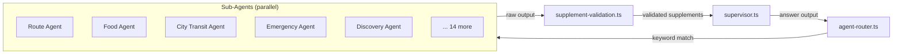
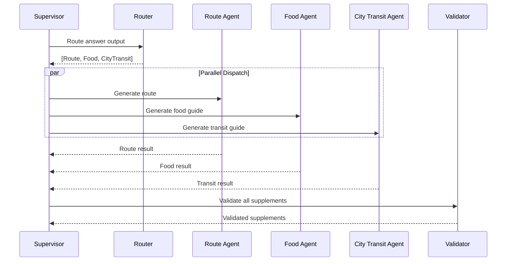
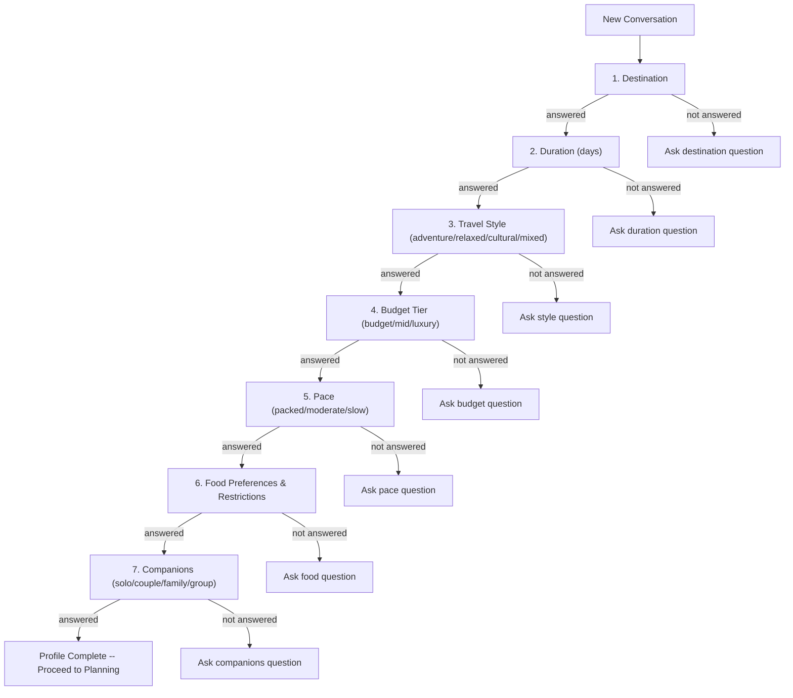
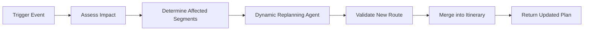

# Multi-Agent System

MapsBridge dispatches 19 specialized sub-agents to produce supplemental content alongside the main answer. This document catalogs every agent, describes the routing and dispatch mechanism, and covers supporting systems such as validation, scoring, and dynamic replanning.

---

## Agent Catalog

| Agent | File | Lines | LLM? | Purpose |
|-------|------|-------|------|---------|
| Route | `route-agent.ts` | 345 | Yes + deterministic fallback | Full multi-day route generation with day-by-day itineraries. Includes hardcoded fallback routes for Roma, Kapadokya, and Tokyo when LLM output fails validation. |
| Emergency | `emergency-agent.ts` | 175 | No (deterministic) | Embassy/consulate information, emergency phone numbers. Covers US, Italy, Japan, France, and Turkey with static data. |
| Transit-Stay | `transit-stay-agent.ts` | 57 | Yes | Accommodation area recommendations, hotel type guidance, transit card information for the destination. |
| Discovery | `discovery-agent.ts` | 52 | Yes | Local specialties, hidden gems, cultural tips that go beyond mainstream tourist content. |
| Food | `food-agent.ts` | 90 | Yes | Gastronomy recommendations with dietary filtering (vegetarian, vegan, halal, gluten-free, allergies). |
| Lodging | `lodging-agent.ts` | 99 | Yes | Accommodation recommendations matched to traveler style and budget tier. |
| Hotel Deal | `hotel-deal-agent.ts` | 113 | Yes | Hotel deal discovery with price context and booking timing advice. |
| Flight | `flight-agent.ts` | 73 | Yes | Flight information, airport logistics, layover guidance. |
| Car Rental | `car-rental-agent.ts` | 68 | Yes | Car rental tips, insurance guidance, driving regulations for the destination. |
| City Transit | `city-transit-agent.ts` | 70 | Yes | Public transport guidance: metro maps, pass options, ride-hailing availability. |
| City Intel | `city-intel-agent.ts` | 64 | Yes | Weather patterns, cultural norms, local etiquette, safety notes. |
| Sports | `sports-agent.ts` | 78 | Yes | Sports venues, outdoor activities, hiking trails, adventure sports. |
| Events | `events-concert-agent.ts` | 89 | Yes | Upcoming events, concerts, festivals, exhibitions at the destination. |
| Art-Culture | `art-culture-agent.ts` | 86 | Yes | Art galleries, museums, cultural landmarks, performing arts. |
| Nightlife | `nightlife-agent.ts` | 83 | Yes | Nightlife districts, bars, clubs, late-night dining. |
| Budget-Luxury | `budget-luxury-agent.ts` | 86 | Yes | Budget-to-luxury tier breakdown: what each price tier gets you at the destination. |
| Dynamic Replanning | `dynamic-replanning-agent.ts` | 82 | Yes | Real-time itinerary adjustments for weather changes, delays, and venue closures. |
| Ticket Tracker | `ticket-tracker-agent.ts` | 118 | Yes | Ticket availability monitoring for attractions, shows, and experiences. |
| DevOps | `devops-agent.ts` | 67 | Yes | System health diagnostics, internal monitoring (admin-only). |

---

## Agent Architecture

---

## Agent Routing

### `agent-router.ts` -- Keyword-Based Routing

The router examines the answer model's structured output and the user's original prompt to determine which sub-agents to dispatch. Routing is keyword-based:

| Keyword Pattern | Dispatched Agent |
|----------------|-----------------|
| Food, restaurant, eat, cuisine, dining | Food Agent |
| Sports, outdoor, hiking, adventure | Sports Agent |
| Hotel, stay, accommodation, lodging | Lodging Agent |
| Flight, airport, airline, fly | Flight Agent |
| Car rental, driving, rent a car | Car Rental Agent |
| Metro, bus, transit, transport | City Transit Agent |
| Weather, culture, etiquette, safety | City Intel Agent |
| Emergency, embassy, consulate, SOS | Emergency Agent |

Multiple agents can match simultaneously. The router returns the full set of matched agents for parallel dispatch.

### Routing Behavior

- **Always dispatched**: The Route Agent runs on every `plan` intent regardless of keyword matches.
- **Deterministic agents**: The Emergency Agent uses no LLM calls -- it returns structured static data based on the destination country.
- **Fallback routes**: The Route Agent carries hardcoded fallback itineraries for Roma, Kapadokya, and Tokyo. If the LLM-generated route fails validation, the fallback is served instead.

---

## Parallel Dispatch Pattern

Sub-agents run concurrently to minimize latency. The supervisor dispatches all matched agents in parallel and collects results with a timeout boundary:

Each agent receives:
- The trip context (destination, days, interests, budget, companions)
- The main answer model's output (so agents can reference it)
- Relevant RAG evidence passages (if available)

Each agent returns a structured supplement that the client renders in dedicated UI sections.

---

## Sub-Agent Output Validation

### `supplement-validation.ts`

Every sub-agent's output passes through validation before inclusion in the response:

- **Schema conformance**: Output must match the expected JSON structure for that agent type.
- **Content bounds**: Text fields are checked against length limits.
- **Cross-reference integrity**: Place names referenced in supplements must appear in the route or place research results.
- **Graceful degradation**: If a sub-agent's output fails validation, it is dropped silently. The response ships without that supplement rather than failing the entire request.

---

## Context Agent

### `context-agent.ts` -- Traveler Persona Builder

The Context Agent is not a sub-agent in the dispatch sense. It runs earlier in the pipeline to build a traveler persona from the user's profile data:

- Travel history and past destinations
- Stated preferences (pace, budget, food restrictions)
- Memory context retrieved from AgentCore
- Companion information (solo, couple, family, group)

The resulting persona object is injected into both the intake and answer model prompts, enabling personalized responses.

---

## Scoring Engine

Located in `services/ai-assistant`, the scoring engine applies deterministic scoring to places and restaurants returned by sub-agents.

### Restaurant Scoring (10 Parameters)

| Parameter | Weight | Description |
|-----------|--------|-------------|
| Cuisine match | High | How well the cuisine matches stated preferences |
| Dietary compatibility | High | Whether dietary restrictions are satisfied |
| Budget fit | Medium | Price range alignment with budget tier |
| Rating | Medium | Aggregate review rating |
| Distance | Medium | Walking distance from current route position |
| Popularity | Low | Visitor volume and trending status |
| Authenticity | Medium | Local vs. tourist-oriented |
| Time suitability | Medium | Open during the planned meal window |
| Companion fit | Low | Appropriate for the travel party type |
| Novelty | Low | How different from previously recommended options |

### Place Scoring (6 Parameters)

| Parameter | Weight | Description |
|-----------|--------|-------------|
| Interest match | High | Alignment with stated interests |
| Rating | Medium | Aggregate review rating |
| Distance | Medium | Proximity to current route segment |
| Visit duration fit | Medium | Whether it fits the available time slot |
| Popularity | Low | General visitor popularity |
| Uniqueness | Low | How distinctive the place is vs. alternatives |

---

## Smart Question Engine

Located in `services/ai-assistant`, the smart question engine drives the concierge-style progressive questioning flow used when the trip profile is incomplete.

### Question Flow

The engine follows a fixed priority order, skipping questions whose answers are already known:

The engine generates natural-language questions, not form fields. Questions adapt to context -- for example, if the user mentions "romantic getaway," the companion question is skipped (inferred as couple).

---

## Dynamic Replanner

Located in `services/ai-assistant`, the dynamic replanner handles mid-trip itinerary adjustments.

### Trigger Types

| Trigger | Description | Response Strategy |
|---------|-------------|-------------------|
| `rain` | Weather forecast shows rain during outdoor activities | Move outdoor items to indoor alternatives; shift outdoor to a clear day if available |
| `late_start` | User indicates late start to the day | Compress or drop lowest-priority stops; preserve must-see items |
| `venue_closed` | A planned venue is unexpectedly closed | Substitute with a nearby alternative of the same category |
| `user_request` | User explicitly asks to change the plan | Re-score remaining stops with updated preferences; regenerate affected day |

### Replanning Flow

The replanner preserves as much of the original itinerary as possible. Only affected time slots are regenerated. Unaffected days remain untouched.
