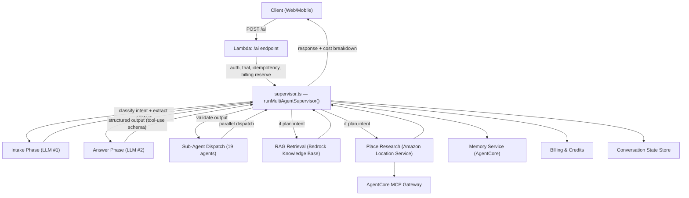
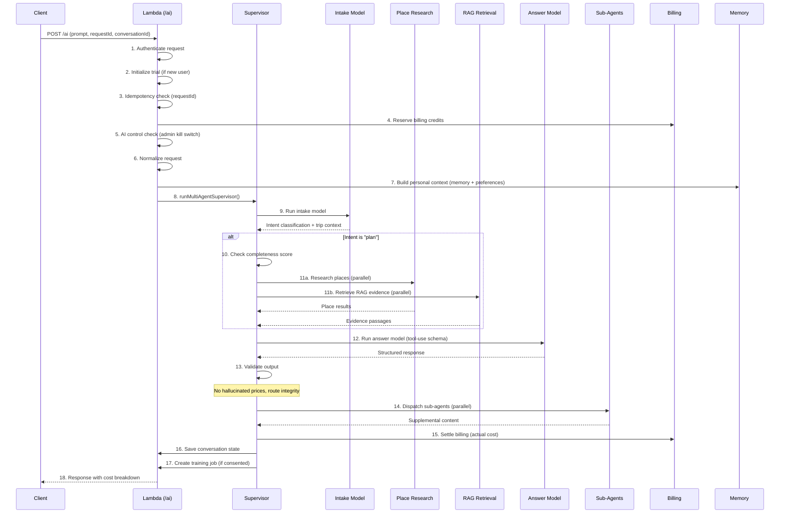

# AI System Architecture

MapsBridge uses a multi-agent AI travel planning system built on AWS Bedrock. This document describes the core pipeline, key components, model tiers, and the full request lifecycle.

---

## High-Level Architecture



---

## Core Pipeline: Two-Phase LLM

MapsBridge processes every user message through a two-phase LLM pipeline. Each phase uses a separate model invocation with distinct responsibilities.

### Phase 1 -- Intake

The intake model receives the raw user prompt along with conversation history and classifies the user's intent into one of three categories:

| Intent | Description |
|--------|-------------|
| `clarify` | Insufficient information to plan; generate clarifying questions |
| `chat` | General conversation, not a planning request |
| `plan` | Actionable travel planning request with enough context |

Beyond classification, the intake model extracts structured trip context: destination, number of days, interests, travel style, dietary constraints, and companion information. This context feeds into the planning state machine (see `planning.ts`).

### Phase 2 -- Answer

The answer model receives the merged context (intake output + trip state + RAG evidence + place research results) and produces a structured response using Bedrock's tool-use schema. The schema enforces output structure so downstream agents and the client can parse the response deterministically.

---

## Key Components

### `supervisor.ts` (449 lines) -- Central Orchestrator

The main entry point is `runMultiAgentSupervisor()`. It owns the full pipeline:

```
guardrails
  -> intake model
  -> context merge
  -> place research (if planning)
  -> RAG retrieval (if planning)
  -> answer model
  -> output validation
  -> sub-agent dispatch (parallel)
  -> response assembly
```

The supervisor is responsible for error boundaries at each stage, cost accumulation across all LLM calls, and assembling the final response envelope.

### `bedrock-client.ts` -- AWS Bedrock Client

Wraps the AWS Bedrock `ConverseCommand` API. Responsibilities:

- JSON schema tool-use integration (structured output enforcement)
- Guardrail attachment (content filtering before and after inference)
- Extended thinking support for complex planning scenarios
- Per-call cost tracking (input tokens, output tokens, model tier)

### `planning.ts` (313 lines) -- Trip Context State Machine

Manages the progressive building of a traveler's trip profile across multiple conversation turns:

- **Profile accumulation**: merges new information from each turn into a persistent trip context
- **Concierge question generation**: produces the next most-useful question to fill context gaps
- **Completeness scoring**: scores the trip profile from 0 to 1.0; planning proceeds only above a configurable threshold
- **State transitions**: tracks whether the user is in early exploration, active planning, or refinement

### `prompts.ts` -- System Prompts and Schemas

Defines four core artifacts:

| Artifact | Purpose |
|----------|---------|
| `INTAKE_PROMPT` | System prompt for the intake classification model |
| `ANSWER_PROMPT` | System prompt for the answer generation model |
| `INTAKE_SCHEMA` | JSON schema for structured intake output |
| `answerSchema()` | Dynamic JSON schema builder for answer output (varies by intent) |

### `agent-router.ts` -- Sub-Agent Routing

Keyword-based router that examines the answer model's output and dispatches relevant sub-agents. Routing targets include food, sports, lodging, flights, car rental, city transit, city intel, and emergency agents. See the [Multi-Agent System](agents.md) document for the full agent catalog.

### `retrieval.ts` -- RAG Retrieval

Retrieves contextual evidence from a Bedrock Knowledge Base:

- Vector similarity search against indexed travel content
- City-level filtering to scope results to the destination
- PII masking on retrieved passages before injection into prompts

### `place-research.ts` -- Place Research

Integrates with Amazon Location Service for point-of-interest geocoding:

- Searches within a 20 km radius of the destination center
- Returns structured place data (name, coordinates, category, address)
- Results feed into both the answer model context and route generation

### `agentcore-gateway.ts` -- AgentCore MCP Gateway

Connects to the AgentCore MCP (Model Context Protocol) gateway for place research operations:

- SigV4 request signing for AWS authentication
- Structured tool invocation over the MCP protocol
- Error handling and retry logic for gateway timeouts

---

## Models Used

### Primary Model

**Claude Haiku** (via AWS Bedrock) serves as the primary model for both intake and answer phases in production.

### Intake Model

A custom or fine-tuned model handles the intake classification phase. If the intake model is unavailable, the system falls back to the primary Claude Haiku model.

### Service Layer -- Four Model Tiers

The AI service layer defines four model tiers used across the system. Sub-agents and auxiliary calls select the appropriate tier based on task complexity:

| Tier | Model | Typical Use |
|------|-------|-------------|
| 1 | Nova Micro | Simple classification, keyword extraction |
| 2 | Nova Lite | Moderate generation, short responses |
| 3 | Claude Haiku 4.5 | Primary planning and conversation |
| 4 | Claude 3.5 Sonnet | Complex reasoning, route generation |

---

## Request Lifecycle

The full lifecycle of a single `/ai` request, from client to response:



### Step-by-Step Detail

1. **Authentication** -- Verify JWT token, extract user identity.
2. **Trial initialization** -- First-time users get a trial credit allocation.
3. **Idempotency check** -- Duplicate `requestId` values return the cached response.
4. **Billing reserve** -- Pre-authorize estimated credits for the request.
5. **AI control check** -- Admin flag can disable AI system-wide for maintenance.
6. **Normalize request** -- Sanitize input, apply character limits, extract metadata.
7. **Build personal context** -- Retrieve user memory from AgentCore and merge with stored preferences. Context is bounded to 1500 UTF-8 bytes.
8. **Call supervisor** -- Hand off to `runMultiAgentSupervisor()`.
9. **Intake model** -- Classify intent, extract trip context, update planning state machine.
10. **Completeness check** -- If the trip profile scores below threshold, generate a clarifying question instead of planning.
11. **Parallel research** -- Place research (Amazon Location Service) and RAG retrieval (Bedrock Knowledge Base) run concurrently.
12. **Answer model** -- Generate structured response using tool-use schema, incorporating all gathered context.
13. **Output validation** -- Verify no hallucinated prices appear in the response; validate route integrity (no duplicate stops, reasonable distances).
14. **Sub-agent dispatch** -- Route-relevant sub-agents run in parallel to produce supplemental content (food guides, transit info, etc.).
15. **Billing settlement** -- Replace the reserve with actual token costs.
16. **Conversation state** -- Persist updated trip context and conversation history.
17. **Training job** -- If the user has consented, create a PII-masked training record.
18. **Return response** -- Send the assembled response with a cost breakdown to the client.
