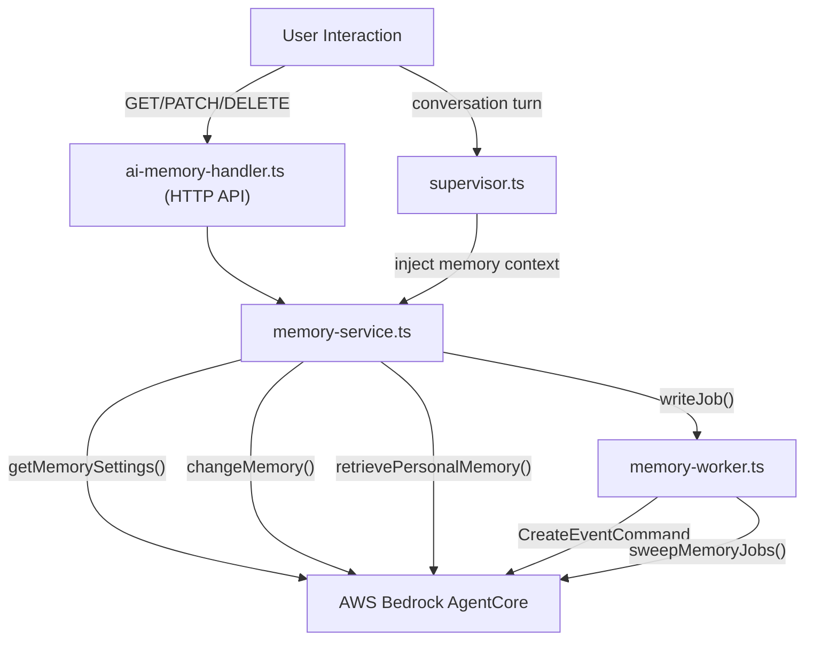
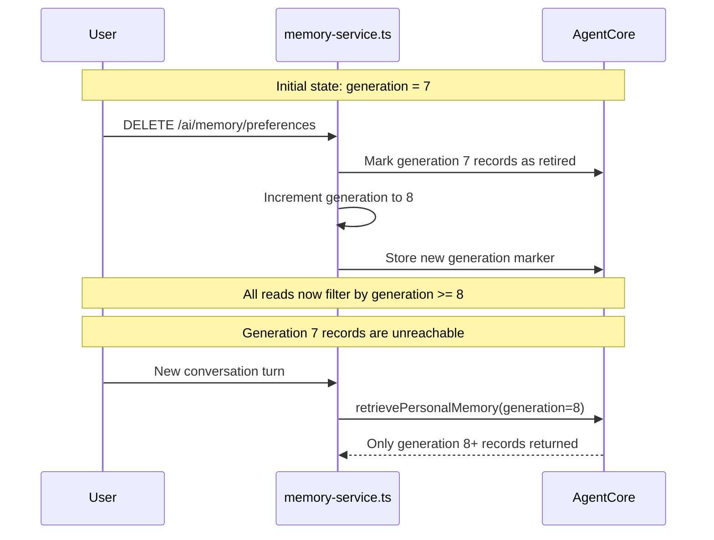
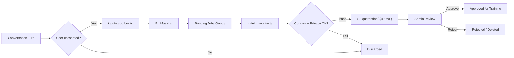
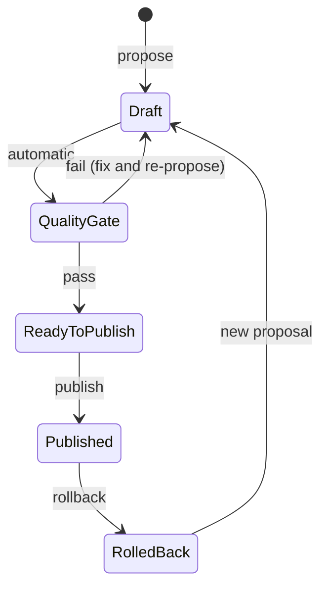
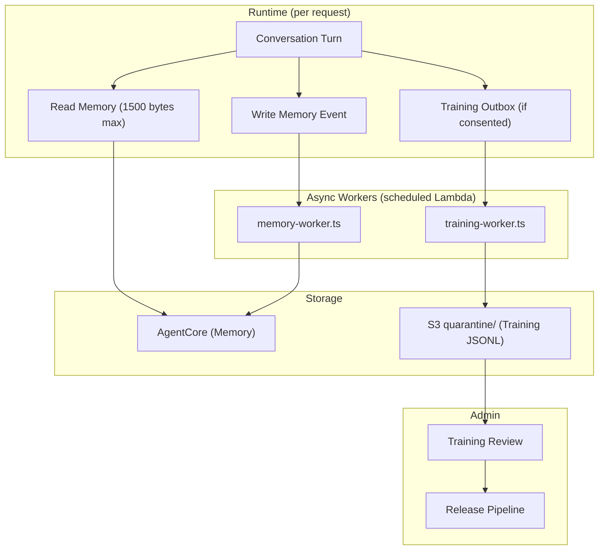

# AI Memory Service & Training Pipeline

MapsBridge maintains per-user AI memory backed by AWS Bedrock AgentCore and a consent-driven training pipeline for model improvement. This document covers the memory lifecycle, training data flow, and the AI release pipeline.

---

## Memory System

### Overview

The memory system stores learned user preferences and travel patterns in AWS Bedrock AgentCore. Memory is scoped per-user and governed by a generation-based consent rotation mechanism that ensures deleted or changed preferences become cryptographically unreachable.

### Core Components

#### `memory-service.ts`

The primary interface for all memory operations:

| Function                   | Description                                                                                 |
| -------------------------- | ------------------------------------------------------------------------------------------- |
| `getMemorySettings()`      | Returns the user's current memory consent state and generation                              |
| `retrievePersonalMemory()` | Fetches stored preferences for context injection (bounded to 1500 UTF-8 bytes)              |
| `changeMemory()`           | Updates or creates a memory record; triggers generation rotation if modifying existing data |
| `writeJob()`               | Enqueues a memory write event for asynchronous processing by the worker                     |

#### `memory-worker.ts`

A scheduled Lambda that processes queued memory events:

| Function             | Description                                                                           |
| -------------------- | ------------------------------------------------------------------------------------- |
| `processMemoryJob()` | Writes pending memory events to AgentCore via `CreateEventCommand`                    |
| `sweepMemoryJobs()`  | Purges memory records belonging to retired actors (deleted accounts, revoked consent) |

Memory records have a **180-day retention period**. After 180 days without updates, records are automatically purged.

#### `ai-memory-handler.ts` -- HTTP API

| Endpoint                 | Method | Description                                              |
| ------------------------ | ------ | -------------------------------------------------------- |
| `/ai/memory/settings`    | GET    | Retrieve current memory consent settings                 |
| `/ai/memory/settings`    | PATCH  | Enable or disable memory collection                      |
| `/ai/memory/preferences` | DELETE | Delete stored preferences (rotates generation)           |
| `/ai/memory`             | DELETE | Delete all memory data for the user (rotates generation) |

### Generation Rotation

Generation rotation is the mechanism that ensures deleted or changed preferences cannot be recovered:

Key properties:

- **Preference change or deletion** triggers a generation rotation.
- Old generation records are not physically deleted immediately but are **filtered out** of all reads.
- The `sweepMemoryJobs()` worker eventually purges retired generation records.
- This provides an immediate logical deletion with eventual physical cleanup.

### Context Injection

When the supervisor builds the prompt for the intake or answer model, it calls `retrievePersonalMemory()` to fetch the user's stored preferences. The returned memory is:

- Bounded to **1500 UTF-8 bytes** to prevent prompt bloat.
- Injected as a structured block within the system prompt.
- Read-only during inference -- the model cannot modify memory directly.

New memory writes happen only through explicit `writeJob()` calls after the response is generated.

---

## Training Pipeline

### Overview

The training pipeline collects consented conversation turns, masks PII, and exports them for model fine-tuning. Every step requires explicit user consent and administrative review.

### Consent Model

- **Per-turn explicit consent**: Each conversation turn must carry a consent flag. Turns without consent are never stored.
- **`TRAINING_CONSENT_VERSION`**: A version identifier tracks which consent terms the user agreed to. If the consent version changes, previously consented data is re-evaluated.
- Consent can be revoked at any time through the memory settings API.

### `training-outbox.ts`

Creates PII-masked training jobs from consented conversation turns:

1. Receives a completed conversation turn with consent flag.
2. Applies PII masking (see below).
3. Creates a training job record in the pending queue.
4. The job includes: masked prompt, masked response, model ID, turn metadata, consent version.

### `training-worker.ts`

A scheduled Lambda that processes pending training jobs:

1. Reads pending jobs from the queue.
2. Validates that consent is still active (not revoked since the job was created).
3. Validates that privacy review requirements are met.
4. Exports validated jobs to S3 under the `quarantine/` prefix as JSONL files.
5. JSONL format follows the Nova/Bedrock fine-tuning specification.

### PII Masking

The following PII patterns are detected and stripped before any training data is stored:

| Pattern                 | Example               | Replacement        |
| ----------------------- | --------------------- | ------------------ |
| Credit card numbers     | `4111 1111 1111 1111` | `[CARD_REDACTED]`  |
| Email addresses         | `user@example.com`    | `[EMAIL_REDACTED]` |
| TC Kimlik (Turkish ID)  | `12345678901`         | `[TCKN_REDACTED]`  |
| Social Security Numbers | `123-45-6789`         | `[SSN_REDACTED]`   |
| Phone numbers           | `+1 (555) 123-4567`   | `[PHONE_REDACTED]` |

PII masking runs at the outbox stage, before the data enters the pending queue. No unmasked PII reaches the training worker or S3.

### Admin Review

| Endpoint                         | Method | Description                                       |
| -------------------------------- | ------ | ------------------------------------------------- |
| `/admin/ai-training`             | GET    | List all pending training jobs (quarantine queue) |
| `/admin/ai-training/{id}/review` | POST   | Approve or reject a specific training job         |

Approved jobs move from `quarantine/` to the training dataset. Rejected jobs are permanently deleted from S3.

---

## AI Release Pipeline

The release pipeline manages the promotion of new AI model versions or configuration changes to production.

### Endpoints

| Endpoint                     | Method | Description                                                                |
| ---------------------------- | ------ | -------------------------------------------------------------------------- |
| `/admin/ai-release`          | GET    | View current pipeline status (active version, pending candidates, history) |
| `/admin/ai-release/propose`  | POST   | Propose a release candidate with quality metrics (accuracy, latency, cost) |
| `/admin/ai-release/publish`  | POST   | Publish the candidate to production (quality gate must pass)               |
| `/admin/ai-release/rollback` | POST   | Roll back to the previous published version                                |

### Quality Gate

Before a release candidate can be published, it must pass automated quality checks:

- **Accuracy threshold**: Measured against a held-out evaluation set.
- **Latency budget**: p50 and p99 latency must remain within bounds.
- **Cost ceiling**: Per-request cost must not exceed the configured maximum.
- **Regression check**: No degradation on key test scenarios compared to the current production version.

If the quality gate fails, the candidate returns to draft status with a diagnostic report indicating which checks failed.

---

## Data Flow Summary

