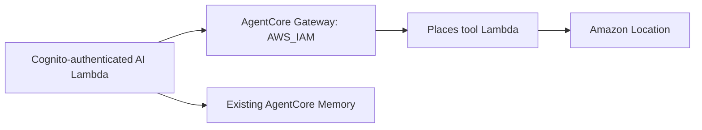

# MapsBridge AgentCore Gateway

Production preparation for the existing Lambda travel supervisor. This stack exposes a real, read-only Amazon Location research tool through an IAM-authorized AgentCore Gateway. The existing `infra/ai-memory` stack continues to provide consent-based AgentCore Memory. It does not migrate the supervisor to AgentCore Runtime.



The existing payment reservation, consent checks and model generation remain in the AI Lambda. Each research task makes one MCP tool call, which geocodes once and performs at most three searches in parallel. Up to 30 validated places return. Only destination and search terms cross the Gateway; user IDs, location history, preferences and conversation text are not forwarded. There is no extra LLM invocation inside the tool.

## Behavior and limits

- `AGENTCORE_GATEWAY_URL` absent: existing direct research path.
- Present: Gateway is authoritative. IAM denial, timeout, tool error or malformed data returns `unavailable`; there is no direct-call fallback.
- `PLACE_RESEARCH_ENABLED` must equal `true`.
- One 8-second budget covers MCP connection/initialization and execution. Responses are limited to 256 KiB, including SSE. Redirects and non-AWS endpoints are rejected before credentials can be forwarded.
- The MCP SDK handles the initialization handshake and JSON/SSE protocol. The Gateway supports `2025-03-26`, `2025-06-18` and `2025-11-25`. Each call gets a fresh MCP client, avoiding cross-request session sharing. AWS credential providers refresh credentials.
- Tool name is `travel___research_places`; the Lambda independently validates the name and arguments.
- The tools role only has `geo-places:Geocode`, `geo-places:SearchText` and its log stream permissions. The Gateway role can invoke only its target Lambda. The caller gets `InvokeGateway` on this Gateway ARN.
- No synthetic weather/prices are published. Existing `gateway-tools.ts` functions are local planning helpers.
- A metadata-only `AgentCoreGatewayCall` log records success and duration in the calling Lambda. Target exceptions feed a CloudWatch alarm. Set `alarm_topic_arn` to an existing SNS topic to deliver alerts; empty means a console-only alarm. This is CloudWatch instrumentation, not a claim of full AgentCore OTEL tracing.

## Build and validate

From the repository root:

```sh
npm ci --ignore-scripts
node infra/scripts/build-agentcore-gateway.cjs
npm --prefix apps/web run build:ai
node --test apps/web/tests/agentcore-gateway.test.cjs
terraform -chdir=infra/agentcore-gateway init -backend=false
terraform -chdir=infra/agentcore-gateway validate
```

Copy `terraform.tfvars.example` to `terraform.tfvars` and set the account, region, prefix and existing AI Lambda execution role. Use a staging prefix and staging role for an isolated trial. Configure your team's protected remote Terraform backend before team deployment; local state must not be committed.

```sh
terraform -chdir=infra/agentcore-gateway plan -out=gateway.tfplan
# Review the plan; creates Gateway, target Lambda, scoped roles/policies, log group and alarm.
terraform -chdir=infra/agentcore-gateway apply gateway.tfplan
```

Before routing application traffic, run `node infra/scripts/verify-agentcore-gateway.cjs` with `AWS_REGION`, `AGENTCORE_GATEWAY_URL` and `AGENTCORE_PLACES_TOOL` from the stack output. Use an IAM principal allowed to invoke the new Gateway. The check performs a real Places lookup and can incur service charges. Also verify that an unauthorized principal is denied. Record cold and warm latency, and ensure the overall AI request fits the existing 30-second Lambda/API deadline. Local tests cannot verify regional availability, IAM propagation, live latency or service quotas.

After a successful smoke test, put `terraform output -json ai_gateway_environment` into the `ai_gateway_environment` variable map of `infra/admin-runtime` and deploy the rebuilt AI Lambda using the existing release workflow. Example shape:

```json
{
  "ai_gateway_environment": {
    "AGENTCORE_GATEWAY_URL": "https://YOUR_GATEWAY.gateway.bedrock-agentcore.eu-central-1.amazonaws.com/mcp",
    "AGENTCORE_PLACES_TOOL": "travel___research_places"
  }
}
```

Keep endpoint configuration server-side. The frontend needs no AWS credentials. `infra/admin-runtime` remains on its existing provider version; the new independent stack uses AWS provider 6 with a committed provider lock file.

Rollback: clear `ai_gateway_environment` and redeploy the AI Lambda. Its original direct Places IAM permission remains available for this explicit rollback. Do not delete the Gateway before switching the caller. Memory, billing and stored conversation state are independent.

## Validation evidence (2026-09-29)

Local web/backend tests, type check, bundle builds and Terraform validation are documented in `../../docs/verification/agentcore-gateway.md`. No live Gateway deployment or smoke invocation is implied by these checks.

## Architecture decision and sources

Use standalone Gateway + existing Memory on Lambda first: this adds a governed reusable tool boundary without changing transactional billing and conversation handling. Gateway adds request overhead and service charges; benchmark end-to-end latency and cost per completed plan before enabling all traffic. No cost savings are claimed without measurements. Revisit AgentCore Runtime when streaming or long-running/background agents require a different execution model. Registry, Browser, Code Interpreter, delegated OAuth Identity and Cedar Policy are not required for the current read-only tool.

Verified using public documentation during this work:

- [AgentCore components](https://docs.aws.amazon.com/bedrock-agentcore/latest/devguide/what-is-bedrock-agentcore.html)
- [Gateway inbound authentication](https://docs.aws.amazon.com/bedrock-agentcore/latest/devguide/gateway-inbound-auth.html)
- [MCP invocation and initialization](https://docs.aws.amazon.com/bedrock-agentcore/latest/devguide/gateway-using.html)
- [Tool naming](https://docs.aws.amazon.com/bedrock-agentcore/latest/devguide/gateway-tool-naming.html)
- [Lambda target argument contract](https://docs.aws.amazon.com/bedrock-agentcore/latest/devguide/gateway-add-target-lambda.html)

AWS MCP was not available. No live pricing or runtime-platform recommendation is asserted.
